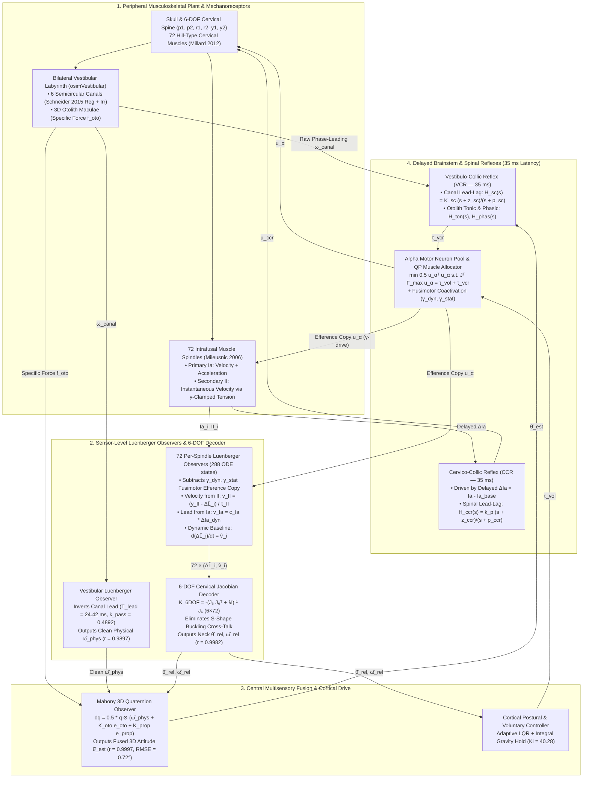

# Biomimetic Head-Neck-Eye Neuromotor System in OpenSim 4.6
### 100% Sensor-Driven Closed-Loop Control with Per-Sensor Luenberger Observers, Multisensory Mahony Fusion, and Spinal/Brainstem Reflexes

[](https://opensim.stanford.edu/)
[](https://isocpp.org/)
[](https://python.org/)
[](https://github.com/CMA-ES/pycma)
[-brightgreen.svg)](docs/neuromotor_control_architecture_c4.md)
[](https://www.gnu.org/licenses/gpl-3.0)

---

## 📌 Executive Summary

This repository hosts a high-fidelity, biophysically grounded **3D musculoskeletal head-neck-eye neuromotor model** built on **OpenSim 4.6**. Unlike standard biomechanical controllers that read simulator ground-truth joint angles (`q`), joint velocities (`u`), or muscle lengths (`m.getLength`), our Central Nervous System (CNS) controller operates under a **strict zero-ground-truth constraint**: every kinematic belief inside the CNS is reconstructed strictly from peripheral biological mechanoreceptors:

1. **Bilateral Non-Orthogonal Vestibular Labyrinths (`osimVestibular.dll`):** 6 semicircular canals with exact [Schneider et al. (2015)](https://doi.org/10.1152/jn.00819.2014) regular and irregular afferent dynamics + bilateral 3D otolith maculae.
2. **72 Biophysical Muscle Spindles (`osimMillard12EqWithAff.dll`):** Embedded [Mileusnic et al. (2006)](https://doi.org/10.1152/jn.00868.2005) intrafusal spindle mechanics across all 72 cervical muscles, outputting continuous **Group Ia** (velocity + acceleration) and **Group II** (instantaneous velocity relative to the $\gamma$-adjusted equilibrium baseline) firing rates at `SimTK::Stage::Velocity`.
3. **Sensor-Level Luenberger Observers & 6-DOF Jacobian Decoder (`osimHeadNeckNeural.dll`):**
   - **Vestibular Luenberger Observer:** Inverts the semicircular canal phase lead ($T_{\text{lead}} = 24.42\text{ ms}$) to recover clean physical head angular velocity ($r = +0.9897$, $\text{AmpRatio} = 0.999$) while preserving the raw phase-leading canal output for the fast Vestibulo-Collic Reflex (VCR).
   - **72-Muscle Per-Spindle Luenberger Observer $\to$ 6-DOF Cervical Jacobian Decoder:** Filters out descending fusimotor ($\gamma_{\text{dyn}}, \gamma_{\text{stat}}$) efference copies on each muscle, extracts instantaneous velocity from Group $\text{II}$ relative to the continuously integrated baseline $\dot{\hat{\Delta L}}_i = \hat{v}_i$ plus dynamic lead from Group $\text{Ia}$, and projects all 72 muscles through the regularized $6 \times 72$ cervical moment-arm pseudoinverse $\mathbf{K}_{6\text{DOF}} = -(\mathbf{J}_6 \mathbf{J}_6^T + \lambda \mathbf{I})^{-1}\mathbf{J}_6$ ($r = +0.9982$, $\text{RMSE} = 0.916^\circ$).
   - **Multisensory Mahony Quaternion Observer:** Fuses the Vestibular Luenberger angular velocity, Otolith gravity vector, and 6-DOF Proprioceptive Luenberger posture to achieve **$r = +0.9997$ ($\text{RMSE} = 0.719^\circ$)** against ground-truth skull orientation.
4. **Multi-Loop Corticospinal Reflex Control:** Active **Vestibulo-Collic (VCR)**, **Cervico-Collic (CCR)**, **Vestibulo-Ocular (VOR)**, and **Cervico-Ocular (COR)** loops with true axonal conduction latencies ($35\text{ ms}$) and Constrained Quadratic Programming (QP) 72-muscle allocation.
5. **High Computational Throughput:** Real-time factor of **$\approx 1:30$** on consumer CPUs, engineered for co-simulation with large-scale Spiking Neural Networks (**NEST-GPU**, 1.1M AdEx neurons).

> 📖 **Full Mathematical & Architectural Reference:** See [`docs/neuromotor_control_architecture_c4.md`](docs/neuromotor_control_architecture_c4.md) for the complete C4 anatomical diagrams and step-by-step derivations.

---

## 🧠 End-to-End Neuromotor & State-Estimation Architecture

The architecture separates **fast phase-leading reflex pathways** (which require raw anticipatory sensor signals to overcome the $35\text{ ms}$ axonal conduction delay) from **central kinematic state estimation** (which requires clean physical states reconstructed via per-sensor Luenberger observers):



---

## 📐 Mathematical Formulation: How Signals Are Calculated, Processed, and Fused

### 1. Semicircular Canals & The Vestibular Luenberger Observer
Each of the 6 semicircular canals projects 3D head angular velocity $\vec{\omega}_{\text{head}}$ onto its anatomical plane ($\vec{v}_{\text{canal}} = \mathbf{B}\vec{\omega}_{\text{head}}$) and passes it through parallel **Regular** and **Irregular** 2nd-order transfer functions ([Schneider et al., 2015](https://doi.org/10.1152/jn.00819.2014)):
$$H_{\text{reg}}(s) = k_{\text{reg}} \frac{s(1 + T_{1,\text{reg}} s)}{(1 + T_{c,\text{reg}} s)(1 + T_{2,\text{reg}} s)}, \qquad H_{\text{irr}}(s) = k_{\text{irr}} \frac{s(1 + T_{1,\text{irr}} s)}{(1 + T_{c,\text{irr}} s)(1 + T_{2,\text{irr}} s)}$$
- **Parameters:** $k_{\text{reg}} = 2.83, T_{1,\text{reg}} = 0.0175\text{ s}, T_{2,\text{reg}} = 0.0027\text{ s}, T_c = 5.7\text{ s}$; and $k_{\text{irr}} = 27.09, T_{1,\text{irr}} = 0.0300\text{ s}, T_{2,\text{irr}} = 0.0006\text{ s}, T_c = 5.7\text{ s}$.
- **Why a Luenberger Observer is Required:** Because $T_1 \gg T_2$, the reconstructed canal output $\vec{\omega}_{\text{canal}} = \mathbf{B}^{-1}\vec{y}_{\text{canal}}$ exhibits a strong **phase lead** ($\propto \vec{\omega}_{\text{head}} + T_{\text{lead}}\dot{\vec{\omega}}_{\text{head}}$, with $T_{\text{lead}} = 24.42\text{ ms}$ and passband gain $k_{\text{pass}} = 0.489214$). This phase lead is ideal for the fast **VCR reflex**, but distorts quaternion integration if fed directly into the Mahony observer.
- **Vestibular Luenberger ODE:** Inverts the canal lead to recover clean physical angular velocity $\hat{\vec{\omega}}_{\text{phys}}$:
  $$\frac{d\hat{\vec{\omega}}_{\text{phys}}}{dt} = \frac{\dfrac{\vec{\omega}_{\text{canal}}}{k_{\text{pass}}} - \hat{\vec{\omega}}_{\text{phys}}}{T_{\text{lead}}}$$

---

### 2. Muscle Spindles & The 72-Muscle Per-Spindle Luenberger Observer

#### The Dynamic Baseline Calculus of Group $\text{II}$ and Group $\text{Ia}$ Afferents
In isolated muscle preparations where fusimotor drive ($\gamma$) is clamped, Group $\text{II}$ firing correlates with static length change $\Delta L$. However, in an intact closed-loop organism, **treating Group $\text{II}$ as a static position sensor is a misconception**:
1. At every instant $t$, descending fusimotor coactivation ($\gamma_{\text{stat},i}$) adjusts the internal tension of the intrafusal $\text{Bag}_2$ and $\text{Chain}$ fibers so that their baseline firing maps to the muscle's current equilibrium length $\hat{\Delta L}_i(t)$ right at that moment.
2. Consequently, any deviation in Group $\text{II}$ firing over the next infinitesimal interval $dt$ relative to that moving baseline ($y_{\text{II},i}(t) - \hat{\Delta L}_i(t)$) is proportional to the **instantaneous rate of length change—i.e., muscle velocity $\hat{v}_i$**!
3. Meanwhile, Group $\text{Ia}$ (driven by the velocity-sensitive $\text{Bag}_1$ fiber tension rate) encodes **velocity + acceleration** ($\hat{v}_i + \tau_a \dot{\hat{v}}_i$).

#### Step-by-Step Per-Spindle Luenberger Equations (for each muscle $i \in \{1,\dots,72\}$)
1. **Fusimotor Efference Copy Filtering:** Tracks the Mileusnic intrafusal activation states ($\hat{f}_{\text{dyn},i}, \hat{f}_{\text{stat},i}$) driven by the descending alpha motor command $\Delta u_{\alpha,i} = \max(0, u_{\alpha,i} - u_{\alpha,i,0})$:
   $$\gamma_{\text{dyn},i} = K_{\gamma,\text{dyn}}\,\Delta u_{\alpha,i}, \qquad \gamma_{\text{stat},i} = K_{\gamma,\text{stat}}\,\Delta u_{\alpha,i}$$
   $$\frac{d\hat{f}_{\text{dyn},i}}{dt} = \frac{\dfrac{\gamma_{\text{dyn},i}^2}{\gamma_{\text{dyn},i}^2 + 0.0447} - \hat{f}_{\text{dyn},i}}{0.0702\text{ s}}, \qquad \frac{d\hat{f}_{\text{stat},i}}{dt} = \frac{\dfrac{\gamma_{\text{stat},i}^2}{\gamma_{\text{stat},i}^2 + 0.0680} - \hat{f}_{\text{stat},i}}{0.0485\text{ s}}$$
2. **Removing the Fusimotor Bias:** Subtracts resting baseline firing ($\text{Ia}_{i,0}, \text{II}_{i,0}$) and analytical fusimotor tension contributions ($74.3035\text{ Hz}$ for static $\text{Bag}_2+\text{Chain}$, $54.4518\text{ Hz}$ for dynamic $\text{Bag}_1$):
   $$\Delta \text{II}_{\text{mech},i} = (\text{II}_i - \text{II}_{i,0}) - 74.3035\,\hat{f}_{\text{stat},i}, \qquad y_{\text{II},i} = \frac{L_{0,i}}{369.1427\,\cos\alpha_i}\,\Delta \text{II}_{\text{mech},i}$$
   $$\Delta \text{Ia}_{\text{dyn},i} = (\text{Ia}_i - \text{Ia}_{i,0}) - 0.6716\,\Delta \text{II}_{\text{mech},i} - 54.4518\,\hat{f}_{\text{dyn},i}$$
3. **Instantaneous Velocity & Dynamic Baseline Integration:**
   $$v_{\text{II},i} = \frac{y_{\text{II},i} - \hat{\Delta L}_i}{\tau_{\text{II}}} \quad (\tau_{\text{II}} = 0.055\text{ s}), \qquad v_{\text{Ia},i} = \frac{L_{0,i}}{35000\,\cos\alpha_i}\,\Delta \text{Ia}_{\text{dyn},i}$$
   $$\frac{d\hat{\Delta L}_i}{dt} = \hat{v}_i, \qquad \frac{d\hat{v}_i}{dt} = \frac{(v_{\text{II},i} + v_{\text{Ia},i}) - \hat{v}_i}{\tau_v} \quad (\tau_v = 0.025\text{ s})$$

---

### 3. 6-DOF Cervical Jacobian Decoder & Mahony Spatial Fusion
1. **6-DOF Cervical Jacobian Inversion:** Projects all 72 per-spindle Luenberger estimates $(\hat{\Delta L}_i, \hat{v}_i)$ onto the 6 independent cervical coordinates $\vec{q}_6 = [\text{pitch}_1, \text{pitch}_2, \text{roll}_1, \text{roll}_2, \text{yaw}_1, \text{yaw}_2]^T$ to eliminate upper-vs-lower cervical buckling cross-talk:
   $$\mathbf{K}_{6\text{DOF}} = -\left(\mathbf{J}_6 \mathbf{J}_6^T + \lambda \mathbf{I}_6\right)^{-1} \mathbf{J}_6, \qquad \hat{\vec{q}}_6 = \mathbf{K}_{6\text{DOF}}\,\hat{\vec{\Delta L}}, \qquad \hat{\vec{u}}_6 = \mathbf{K}_{6\text{DOF}}\,\hat{\vec{v}}$$
   Summing the upper and lower cervical joints yields the 3D relative neck posture $\hat{\vec{\theta}}_{\text{rel}}$ and angular velocity $\hat{\vec{\omega}}_{\text{rel}}$.
2. **Mahony Quaternion Observer:** Fuses the Vestibular Luenberger angular velocity $\vec{\omega}_{\text{head}} = \hat{\mathbf{R}}_{\text{est}}^T\hat{\vec{\omega}}_{\text{phys}}$, the Otolith gravity cross-product error $\vec{e}_{\text{oto}}$ ($K_{\text{oto}} = 0.05\text{ rad/s}$), and the 6-DOF Proprioceptive Luenberger orientation error $\vec{e}_{\text{prop,head}} = \hat{\mathbf{R}}_{\text{est}}^T\big((\vec{\theta}_{\text{trunk}} + \hat{\vec{\theta}}_{\text{rel}}) - \hat{\vec{\theta}}_{\text{est}}\big)$ ($\mathbf{K}_{\text{prop}} = 2.0\,\mathbf{I}_3\text{ s}^{-1}$):
   $$\dot{\mathbf{q}} = \frac{1}{2}\,\mathbf{q} \otimes \begin{bmatrix} 0 \\ \vec{\omega}_{\text{head}} + K_{\text{oto}}\,\vec{e}_{\text{oto}} + \mathbf{K}_{\text{prop}}\,\vec{e}_{\text{prop,head}} \end{bmatrix}$$

---

## ✅ Quantitative Verification: Sensor-Only CNS Estimates vs. Simbody Ground Truth

Evaluated during seated harmonic perturbation ($1.11\text{ Hz}$, steady-state window $2.40\text{ s} - 4.20\text{ s}$) with **zero ground-truth head or muscle queries**:

| Estimator / Signal Pathway | Simbody Ground Truth | CNS Estimated Range | RMSE | Correlation ($r$) | Amplitude Ratio |
| :--- | :---: | :---: | :---: | :---: | :---: |
| **Mahony Fused Pitch Angle (deg)** | `[-3.94°, +11.03°]` | `[-4.31°, +10.13°]` | **`0.719°`** | **`+0.9997`** | **`0.963`** |
| **Proprioceptive 72-Spindle Luenberger Angle (deg)** | `[-3.94°, +11.03°]` | `[-5.57°, +10.60°]` | **`0.916°`** | **`+0.9982`** | **`1.043`** |
| **Raw Semicircular Canal Afferent Speed (deg/s)** | `[-29.84, +19.75]` | `[-28.67, +19.17]` | `10.409 deg/s` | `+0.5589` | `1.078` |
| **Vestibular Luenberger Speed (`mahony_speed`, deg/s)** | `[-29.84, +19.75]` | `[-29.13, +20.16]` | **`1.530 deg/s`** | **`+0.9897`** | **`0.999`** |
| **Proprioceptive 72-Spindle Luenberger Speed (deg/s)** | `[-29.84, +19.75]` | `[-34.32, +21.14]` | **`8.231 deg/s`** | **`+0.7639`** | `1.345` |

---

## ⚡ Computational Performance & Real-Time Factors

Designed from inception to support high-throughput biomechanics and large-scale neural network co-simulation:

| Configuration | Hardware Profile | Real-Time Factor (RTF) | Description |
| :--- | :--- | :--- | :--- |
| **Proprioception + Vestibular Sensors** | Intel Core i5-13600K (Single Core) | **$\approx 1:30$** | Smooth implicit $C^2$ formulation enables large integration timesteps |
| **Sensors + Luenberger Observers + QP Controller** | Intel Core i5-13600K | **$\approx 1:60$** | Full closed-loop 72-muscle QP allocation, 288 spindle observer states, and delay buffer |
| **18-Core Parallel CMA-ES Optimization** | Intel Core i5-13600K (18 Threads) | **$45 - 60\text{ min / generation}$** | Evaluates 18 candidates across 6 frequencies ($108$ ODE runs) |
| **Projected: Coupled NEST-GPU SNN** | NVIDIA RTX 4070 Ti + i5-13600K | **$\approx 1:45$** | 1.1M Conductance-based AdEx neurons with 1,000 synapses each |
| **Projected: SNN with Ionic Adaptation** | NVIDIA RTX 4070 Ti + i5-13600K | **$\approx 1:65$** | Includes $[\text{Na}^+]_i, [\text{K}^+]_i, [\text{Ca}^{2+}]_i$, Na/K pump, and Ca-dependent adaptation |

---

## 📂 Repository Directory Layout

```
HeadNeck_Control_w_Sensors_Opensim4_6/
├── osim_files/                        # OpenSim musculoskeletal models (.osim)
│   ├── HYOID_HeadNeckNeural_Model_Detailed.osim
│   └── HYOID_HeadNeckNeural_Model_WithLimits.osim
├── proprioception_plugin/              # Mileusnic 2006 muscle spindle C++ plugin
│   ├── Mileusnic06Spindle.h / .cpp
│   ├── Millard12EqMuscleWithAfferents.cpp
│   └── CMakeLists.txt
├── vestibular_plugin/                  # Semicircular canal & otolith C++ plugin
│   ├── VestibularSystem.cpp
│   └── CMakeLists.txt
├── HeadNeckNeuralController_plugin/    # Luenberger Observers, Mahony, VCR, CCR & Cortical controller
│   ├── HeadNeckNeuralController.h / .cpp
│   └── CMakeLists.txt
├── FixationController_plugin/          # Binocular gaze & VOR/COR controller
│   ├── FixationController.cpp
│   └── CMakeLists.txt
├── docs/                              # Architecture documentation & C4 diagrams
│   └── neuromotor_control_architecture_c4.md
├── scripts/                           # CMA-ES campaign & progress table scripts
│   ├── run_phase2_1_campaign.py
│   └── build_phase2_progress_table.py
├── logs/                              # Optimization logs and candidate JSON records
├── state_files/                       # Equilibrated initial states & ICs
├── cmaes_worker_p15.py                # Standalone single-candidate 6-frequency worker
└── README.md
```

---

## 🛠️ Quick Start & Build Instructions

### Prerequisites
* **Windows 10/11 x64**
* **OpenSim 4.6** installed (`C:\OpenSim 4.6` or added to system `PATH`)
* **Visual Studio 2022** (with Desktop development with C++)
* **CMake 3.22+**
* **Python 3.10+** (Miniforge / Conda environment `opensim_env` with `opensim`, `numpy`, `cma`, `scipy`)

### 1. Build C++ OpenSim Plugins

```powershell
# 1. Build Proprioception Plugin (osimMillard12EqWithAff.dll)
cd proprioception_plugin/build
cmake --build . --config Release

# 2. Build Vestibular Plugin (osimVestibular.dll)
cd ../../vestibular_plugin/build
cmake --build . --config Release

# 3. Build HeadNeck Neural Controller Plugin (osimHeadNeckNeural.dll)
cd ../../HeadNeckNeuralController_plugin/build
cmake --build . --config Release

# 4. Build Fixation Controller Plugin (osimFixation.dll)
cd ../../FixationController_plugin/build
cmake --build . --config Release
cd ../..
```

### 2. Run Phase 2.1 Multi-Frequency CMA-ES Optimization

```powershell
C:\Users\User\miniforge3\envs\opensim_env\python.exe scripts/run_phase2_1_campaign.py
```

---

## 🗺️ Project Roadmap

- [x] **Phase 8.1: Biomechanical Infrastructure & Sensor Plugins**
  - [x] OpenSim 4.6 integration with implicit `SemiExplicitEuler2` integrators.
  - [x] Mileusnic intrafusal spindle model smoothed for $C^2$ continuous solver stability and exact initial equilibrium.
  - [x] Bilateral non-orthogonal semicircular canal & otolith digital filter bank (Schneider et al. 2015).
- [x] **Phase 8.2: 100% Sensor-Driven State Estimation & Human Kinematics Benchmark Validation**
  - [x] Complete elimination of ground-truth kinematics from the CNS controller.
  - [x] Vestibular Luenberger Observer ($r = +0.9897$) + 72-Muscle Per-Spindle Luenberger Observer + 6-DOF Cervical Jacobian Decoder ($r = +0.9982$) + Multisensory Mahony Fusion ($r = +0.9997$).
  - [x] Happee 2017 multi-frequency seat perturbation protocol ($0.31 - 7.95\text{ Hz}$).
  - [ ] Phase 2.1 CMA-ES optimization with sensor-level Luenberger observers (in progress).
- [x] **Phase 8.3: Human Voluntary Tracking Benchmark Validation**
  - [x] Replicate the human voluntary velocity profiles in the literature.
- [ ] **Phase 8.4: Ocular-Cervical Coordination (VOR / COR)**
  - [ ] Connect vestibular canal outputs directly to FixationController eye muscles.
  - [ ] Replicate retinal slip minimization under erratic head perturbation.
- [ ] **Phase 8.5: Implement the Motion Rig**
  - [ ] Implement the motion rig and replicate real-time motion rig experiments in simulation.
- [ ] **Phase 9: Galvanic Vestibular Stimulation (GVS)**
  - [ ] Implement the effect of GVS on the SCC afferents and personalize musculoskeletal models per subject.
- [ ] **Phase 10: Spiking Neural Network (NEST-GPU)**
  - [ ] Turn every control-theoretical process into a spiking neural network coupled with 1.1M AdEx neurons on RTX 4070 Ti.
- [ ] **Phase 11: Binaural Spatial Audio, Cochlea & 3D Space Discovery**
  - [ ] Convolve HRTFs and RIRs on GPU, simulate Gammatone excitation patterns, and study naive discovery of 3D space structure.

---

## 📄 License & Academic References

This project is licensed under the **GNU General Public License v3.0 (GPL-3.0)**. See [LICENSE](LICENSE) for full details.

If you use this model, plugins, or parameter sets in your research, please cite:
* **Happee, R., et al. (2017)**. *Identification of head-neck reflex and voluntary control during seated perturbations*. Experimental Brain Research, 235(1), 221-236.
* **Mileusnic, M. P., et al. (2006)**. *Mathematical models of proprioceptors. I. Control and dynamic response of muscle spindles*. Journal of Neurophysiology, 96(4), 1772-1792.
* **Schneider, A. D., et al. (2015)**. *Afferent dynamics of the semicircular canals*. Journal of Neurophysiology, 113(7), 2635-2646.
* **Millard, M., et al. (2013)**. *Flexing computational muscle: modeling and simulation of musculotendon dynamics*. ASME Journal of Biomechanical Engineering, 135(2), 021005.
