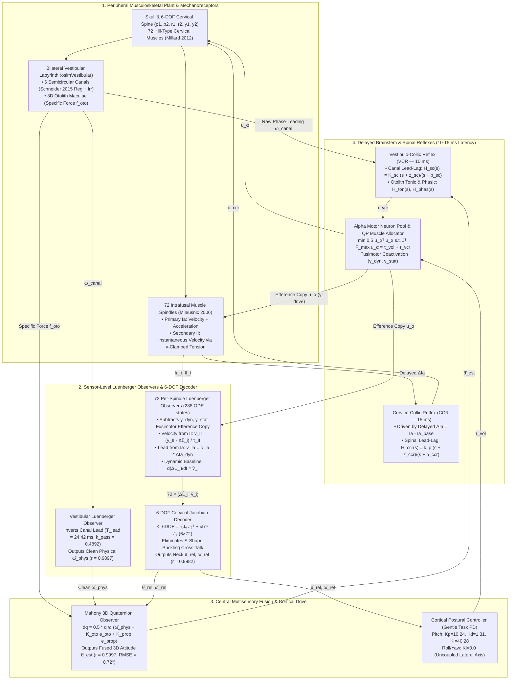

# Biomimetic Head-Neck-Eye Neuromotor System in OpenSim 4.6
### 100% Sensor-Driven Closed-Loop Control with Per-Sensor Luenberger Observers, Multisensory Mahony Fusion, and Spinal/Brainstem Reflexes

[](https://opensim.stanford.edu/)
[](https://isocpp.org/)
[](https://python.org/)
[-brightgreen.svg)](https://github.com/CMA-ES/pycma)
[-brightgreen.svg)](docs/neuromotor_control_architecture_c4.md)
[](https://www.gnu.org/licenses/gpl-3.0)

---

## 📌 Executive Summary

This repository hosts a high-fidelity, biophysically grounded **3D musculoskeletal head-neck-eye neuromotor model** built on **OpenSim 4.6**. Unlike standard biomechanical controllers that read simulator ground-truth joint angles (`q`), joint velocities (`u`), or muscle lengths (`m.getLength`), our Central Nervous System (CNS) controller operates under a **strict zero-ground-truth constraint**: every kinematic belief inside the CNS is reconstructed strictly from peripheral biological mechanoreceptors:

1. **Bilateral Non-Orthogonal Vestibular Labyrinths (`osimVestibular.dll`):** 6 semicircular canals with exact [Schneider et al. (2015)](https://doi.org/10.1152/jn.00819.2014) regular and irregular afferent dynamics + bilateral 3D otolith maculae.
2. **72 Biophysical Muscle Spindles (`osimMillard12EqWithAff.dll`):** Embedded [Mileusnic et al. (2006)](https://doi.org/10.1152/jn.00868.2005) intrafusal spindle mechanics across all 72 cervical muscles, outputting continuous **Group Ia** (velocity + acceleration) and **Group II** (instantaneous velocity relative to the $\gamma$-adjusted equilibrium baseline) firing rates at `SimTK::Stage::Velocity`.
3. **Sensor-Level Luenberger Observers & 6-DOF Jacobian Decoder (`osimHeadNeckNeural.dll`):**
   - **Vestibular Luenberger Observer:** Inverts the semicircular canal phase lead ($T_{\text{lead}} = 24.42\text{ ms}$) to recover clean physical head angular velocity ($r = +0.9897$, $\text{AmpRatio} = 0.999$) while preserving the raw phase-leading canal output for the fast Vestibulo-Collic Reflex (VCR).
   - **72-Muscle Per-Spindle Luenberger Observer $\to$ 6-DOF Cervical Jacobian Decoder:** Filters out descending fusimotor ($\gamma_{\text{dyn}}, \gamma_{\text{stat}}$) efference copies on each muscle, extracts instantaneous velocity from Group $\text{II}$ relative to the continuously integrated baseline $\dot{\hat{\Delta L}}_i = \hat{v}_i$ plus dynamic lead from Group $\text{Ia}$, and projects all 72 muscles through the regularized $6 \times 72$ cervical moment-arm pseudoinverse $\mathbf{K}_{6\text{DOF}} = -(\mathbf{J}_6 \mathbf{J}_6^T + \lambda \mathbf{I})^{-1}\mathbf{J}_6$ ($r = +0.9982$, $\text{RMSE} = 0.916^\circ$).
   - **Multisensory Mahony Quaternion Observer:** Fuses the Vestibular Luenberger angular velocity, Otolith gravity vector, and 6-DOF Proprioceptive Luenberger posture to achieve **$r = +0.9997$ ($\text{RMSE} = 0.719^\circ$)** against ground-truth skull orientation.
4. **Physically Grounded Task-Space & Decoupled Postural Control:**
   - **Direct Inverted-Pendulum Task Gains:** Replaces legacy $W$-value formulas with direct physical PD control ($K_p = 10.24\text{ Nm/rad}, K_d = 1.31\text{ Nms/rad}$ in pitch; $K_p = 10.21, K_d = 1.29$ in roll; $K_p = 0.24, K_d = 0.12$ in yaw).
   - **Decoupled Integrator:** Static gravity trim is restricted strictly to pitch ($K_{i,\text{pitch}} = 40.28\text{ Nm/(rad}\cdot\text{s)}$) with zero roll/yaw integration ($K_{i,\text{roll}}=0, K_{i,\text{yaw}}=0$), completely eliminating lateral cross-talk and yaw windup.
5. **Multi-Loop Corticospinal Reflex Control & Paradigm A Biomechanical Limits:**
   - Active **Vestibulo-Collic (VCR)**, **Cervico-Collic (CCR)**, **Vestibulo-Ocular (VOR)**, and **Cervico-Ocular (COR)** loops with true axonal conduction latencies ($10 - 15\text{ ms}$) and Constrained Quadratic Programming (QP) 72-muscle allocation.
   - **Paradigm A Containment Hierarchy:** Calibrated against cervical spine literature (*White & Panjabi 1990; Dvorak 1993; Vasavada 1998; Nightingale 2002, 2007*): zero-force deadbands end at $75\%$ of voluntary ROM, $C^1$ transition zones span $75\% \to 100\%$, progressive capsular stiffness acts beyond $100\%$, and hard kinematic stops sit at $120\%$ ROM. Premature simulation stopping triggers immediately upon entering the transition zone.
6. **High Computational Throughput:** Real-time factor of **$\approx 1:30$** on consumer CPUs, engineered for co-simulation with large-scale Spiking Neural Networks (**NEST-GPU**, 1.1M AdEx neurons).

> 📖 **Full Mathematical & Architectural Reference:** See [`docs/neuromotor_control_architecture_c4.md`](docs/neuromotor_control_architecture_c4.md) for complete C4 anatomical diagrams and step-by-step derivations.

---

## 🧠 End-to-End Neuromotor & State-Estimation Architecture

The architecture separates **fast phase-leading reflex pathways** (which require raw anticipatory sensor signals to overcome axonal conduction delays) from **central kinematic state estimation** (which requires clean physical states reconstructed via per-sensor Luenberger observers):



---

## 📐 Mathematical Formulation

### 1. Semicircular Canals & The Vestibular Luenberger Observer
Each of the 6 semicircular canals projects 3D head angular velocity $\vec{\omega}_{\text{head}}$ onto its anatomical plane ($\vec{v}_{\text{canal}} = \mathbf{B}\vec{\omega}_{\text{head}}$) and passes it through parallel **Regular** and **Irregular** 2nd-order transfer functions ([Schneider et al., 2015](https://doi.org/10.1152/jn.00819.2014)):
$$H_{\text{reg}}(s) = k_{\text{reg}} \frac{s(1 + T_{1,\text{reg}} s)}{(1 + T_{c,\text{reg}} s)(1 + T_{2,\text{reg}} s)}, \qquad H_{\text{irr}}(s) = k_{\text{irr}} \frac{s(1 + T_{1,\text{irr}} s)}{(1 + T_{c,\text{irr}} s)(1 + T_{2,\text{irr}} s)}$$
- **Parameters:** $k_{\text{reg}} = 2.83, T_{1,\text{reg}} = 0.0175\text{ s}, T_{2,\text{reg}} = 0.0027\text{ s}, T_c = 5.7\text{ s}$; and $k_{\text{irr}} = 27.09, T_{1,\text{irr}} = 0.0300\text{ s}, T_{2,\text{irr}} = 0.0006\text{ s}, T_c = 5.7\text{ s}$.
- **Vestibular Luenberger ODE:** Inverts the canal lead ($T_{\text{lead}} = 24.42\text{ ms}$, passband gain $k_{\text{pass}} = 0.489214$) to recover clean physical angular velocity $\hat{\vec{\omega}}_{\text{phys}}$:
  $$\frac{d\hat{\vec{\omega}}_{\text{phys}}}{dt} = \frac{\dfrac{\vec{\omega}_{\text{canal}}}{k_{\text{pass}}} - \hat{\vec{\omega}}_{\text{phys}}}{T_{\text{lead}}}$$

---

### 2. Muscle Spindles & The 72-Muscle Per-Spindle Luenberger Observer
1. **Fusimotor Efference Copy Filtering:** Tracks Mileusnic intrafusal activation states ($\hat{f}_{\text{dyn},i}, \hat{f}_{\text{stat},i}$) driven by descending alpha motor commands $\Delta u_{\alpha,i}$:
   $$\gamma_{\text{dyn},i} = 100\,K_{\gamma,\text{dyn}}\,\Delta u_{\alpha,i}, \qquad \gamma_{\text{stat},i} = 100\,K_{\gamma,\text{stat}}\,\Delta u_{\alpha,i}$$
   $$\frac{d\hat{f}_{\text{dyn},i}}{dt} = \frac{\dfrac{\gamma_{\text{dyn},i}^2}{\gamma_{\text{dyn},i}^2 + 3600} - \hat{f}_{\text{dyn},i}}{0.149\text{ s}}, \qquad \frac{d\hat{f}_{\text{stat},i}}{dt} = \frac{\dfrac{\gamma_{\text{stat},i}^2}{\gamma_{\text{stat},i}^2 + 3600} - \hat{f}_{\text{stat},i}}{0.205\text{ s}}$$
2. **Removing the Fusimotor Bias:**
   $$\Delta \text{II}_{\text{mech},i} = (\text{II}_i - \text{II}_{i,0}) - 29.7214\,\hat{f}_{\text{stat},i} - 44.5821\,\hat{f}_{\text{chain},i}$$
   $$\Delta \text{Ia}_{\text{dyn},i} = (\text{Ia}_i - \text{Ia}_{i,0}) - 1.3793\,\Delta \text{II}_{\text{mech},i} - 54.4518\,\hat{f}_{\text{dyn},i}$$
   $$y_{\text{II},i} = \frac{L_{0,i}}{369.1427\,\cos\alpha_i}\,\Delta \text{II}_{\text{mech},i}$$
3. **Instantaneous Velocity & Dynamic Baseline Integration:**
   $$v_{\text{II},i} = \frac{y_{\text{II},i} - \hat{\Delta L}_i}{\tau_{\text{II}}} \quad (\tau_{\text{II}} = 0.055\text{ s}), \qquad v_{\text{Ia},i} = \frac{L_{0,i}}{35000\,\cos\alpha_i}\,\Delta \text{Ia}_{\text{dyn},i}$$
   $$\frac{d\hat{\Delta L}_i}{dt} = \hat{v}_i, \qquad \frac{d\hat{v}_i}{dt} = \frac{(v_{\text{II},i} + v_{\text{Ia},i}) - \hat{v}_i}{\tau_v} \quad (\tau_v = 0.025\text{ s})$$

---

### 3. 6-DOF Cervical Jacobian Decoder & Mahony Spatial Fusion
1. **6-DOF Cervical Inversion:** Projects all 72 Luenberger states onto independent joint coordinates to eliminate S-shape intervertebral buckling cross-talk:
   $$\mathbf{K}_{6\text{DOF}} = -\left(\mathbf{J}_6 \mathbf{J}_6^T + \lambda \mathbf{I}_6\right)^{-1} \mathbf{J}_6, \qquad \hat{\vec{q}}_6 = \mathbf{K}_{6\text{DOF}}\,\hat{\vec{\Delta L}}, \qquad \hat{\vec{u}}_6 = \mathbf{K}_{6\text{DOF}}\,\hat{\vec{v}}$$
2. **Mahony Quaternion Observer:**
   $$\dot{\mathbf{q}} = \frac{1}{2}\,\mathbf{q} \otimes \begin{bmatrix} 0 \\ \vec{\omega}_{\text{head}} + K_{\text{oto}}\,\vec{e}_{\text{oto}} + \mathbf{K}_{\text{prop}}\,\vec{e}_{\text{prop,head}} \end{bmatrix}$$
   with $K_{\text{oto}} = 0.05\text{ rad/s}$ and $\mathbf{K}_{\text{prop}} = \text{diag}(2.0, 2.0, 2.0)\text{ s}^{-1}$.

---

## 🏛️ Paradigm A Biomechanical Joint Limits

Calibrated strictly against classical cervical biomechanics literature (*White & Panjabi 1990; Dvorak et al. 1993; Vasavada et al. 1998; Nightingale et al. 2002, 2007*):

| Coordinate | Anatomical Unit | 100% Voluntary ROM ($AROM_{100\%}$) | Zero-Force Deadband ($0 \to 75\%$) | Transition Width ($75\% \to 100\%$) | Hard Bounds ($120\%$ Stop) |
| :--- | :---: | :---: | :---: | :---: | :---: |
| **`pitch1`** | Upper Neck (Occiput–C1–C2) | $[-16.0^\circ, +24.0^\circ]$ | **$[-12.0^\circ, +18.0^\circ]$** | $5.0^\circ$ ($0.0873\text{ rad}$) | **$[-19.2^\circ, +28.8^\circ]$** |
| **`pitch2`** | Lower Neck (C2–C7/T1) | $[-33.0^\circ, +48.0^\circ]$ | **$[-24.75^\circ, +36.0^\circ]$** | $10.0^\circ$ ($0.1745\text{ rad}$) | **$[-39.6^\circ, +57.6^\circ]$** |
| **`roll1`** | Upper Neck (Occiput–C1) | $[-6.0^\circ, +6.0^\circ]$ | **$[-4.5^\circ, +4.5^\circ]$** | $1.5^\circ$ ($0.0262\text{ rad}$) | **$[-7.2^\circ, +7.2^\circ]$** |
| **`roll2`** | Lower Neck (C2–C7) | $[-33.0^\circ, +33.0^\circ]$ | **$[-24.75^\circ, +24.75^\circ]$** | $8.25^\circ$ ($0.1440\text{ rad}$) | **$[-39.6^\circ, +39.6^\circ]$** |
| **`yaw1`** | Upper Neck (C1–C2 Pivot) | $[-38.0^\circ, +38.0^\circ]$ | **$[-28.5^\circ, +28.5^\circ]$** | $9.5^\circ$ ($0.1658\text{ rad}$) | **$[-45.6^\circ, +45.6^\circ]$** |
| **`yaw2`** | Lower Neck (C2–C7) | $[-27.0^\circ, +27.0^\circ]$ | **$[-20.25^\circ, +20.25^\circ]$** | $6.75^\circ$ ($0.1178\text{ rad}$) | **$[-32.4^\circ, +32.4^\circ]$** |

* **Premature Stop Rule:** Any candidate whose joint coordinates leave the zero-force deadband and cross into the transition zone is immediately aborted as weak or unstable.

---

## 📂 Repository Directory Layout

```
HeadNeck_Control_w_Sensors_Opensim4_6/
├── osim_files/                        # OpenSim musculoskeletal models (.osim)
│   ├── HYOID_HeadNeckNeural_Model_Detailed.osim   # Canonical active model (Paradigm A limits)
│   └── HYOID_HeadNeckNeural_Model_WithLimits.osim
├── proprioception_plugin/              # Mileusnic 2006 muscle spindle C++ plugin
│   ├── Mileusnic06Spindle.h / .cpp
│   ├── Millard12EqMuscleWithAfferents.cpp
│   └── CMakeLists.txt
├── vestibular_plugin/                  # Semicircular canal & otolith C++ plugin
│   ├── VestibularSystem.cpp
│   └── CMakeLists.txt
├── HeadNeckNeuralController_plugin/    # Neural Controller, Observers, VCR, CCR & Decoupled Task space
│   ├── HeadNeckNeuralController.h / .cpp
│   └── CMakeLists.txt
├── FixationController_plugin/          # Binocular gaze & VOR/COR controller
│   ├── FixationController.cpp
│   └── CMakeLists.txt
├── docs/                              # Architecture documentation & C4 diagrams
│   └── neuromotor_control_architecture_c4.md
├── data/                              # Benchmark candidate definitions & pre-screen champions
│   ├── prescreen_rational_champion.json  # Phase 2.4 starting centroid (x0) and healthy sigmas
│   └── prescreen_64k_best_candidate.json # 64k Sobol pre-screen champion
├── scripts/                           # Optimization campaigns & analysis tools
│   ├── run_phase2_4_campaign.py       # Active Phase 2.4 30-Generation CMA-ES Campaign
│   └── build_phase2_progress_table.py
├── logs/                              # Optimization logs, candidate summaries, progress matrix
│   ├── phase2_4_campaign.log
│   ├── cervical_72_muscle_parameters.json
│   └── candidates/
├── cmaes_worker_p22.py                # Standalone 6-frequency worker on unapproximated OpenSim
└── README.md
```

---

## 🛠️ Quick Start & Build Instructions

### Prerequisites
* **Windows 10/11 x64**
* **OpenSim 4.6** installed (`C:\OpenSim 4.6` or on system `PATH`)
* **Visual Studio 2022** (Desktop development with C++)
* **CMake 3.22+**
* **Python 3.10+** (Conda environment `opensim_env` with `opensim`, `numpy`, `cma`, `scipy`)

### 1. Build C++ OpenSim Plugins

```powershell
# 1. Build Proprioception Plugin (osimMillard12EqWithAff.dll)
cd proprioception_plugin/build
cmake --build . --config Release

# 2. Build Vestibular Plugin (osimVestibular.dll)
cd ../../vestibular_plugin/build
cmake --build . --config Release

# 3. Build HeadNeck Neural Controller Plugin (osimHeadNeckNeural.dll)
cd ../../HeadNeckNeuralController_plugin/build
cmake --build . --config Release

# 4. Build Fixation Controller Plugin (osimFixation.dll)
cd ../../FixationController_plugin/build
cmake --build . --config Release
cd ../..
```

### 2. Run Phase 2.4 CMA-ES Optimization Campaign

The campaign initializes directly from the **First-Principles Rational Centroid** (`data/prescreen_rational_champion.json`), running 18 candidates in parallel across 14 cores using unapproximated OpenSim integration:

```powershell
C:\Users\User\miniforge3\envs\opensim_env\python.exe scripts/run_phase2_4_campaign.py
```

* **Target Benchmark to Beat:** Happee (2017) model score = **`2,803.88 pts`**.

---

## 📄 Academic References

If you use this model, plugins, or parameter sets in your research, please cite:
* **Happee, R., et al. (2017)**. *Identification of head-neck reflex and voluntary control during seated perturbations*. Experimental Brain Research, 235(1), 221-236.
* **Mileusnic, M. P., et al. (2006)**. *Mathematical models of proprioceptors. I. Control and dynamic response of muscle spindles*. Journal of Neurophysiology, 96(4), 1772-1792.
* **Schneider, A. D., et al. (2015)**. *Afferent dynamics of the semicircular canals*. Journal of Neurophysiology, 113(7), 2635-2646.
* **Vasavada, A. N., et al. (1998)**. *Influence of muscle morphometry and moment arms on head and neck kinematics*. Journal of Biomechanics, 31(6), 547-558.
* **Mortensen, J. D., et al. (2018)**. *A musculoskeletal model of the human neck with scaled strength and updated inertia*. PLOS ONE, 13(12), e0209939.
