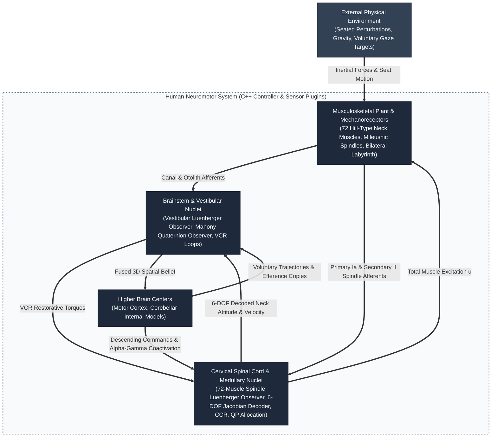
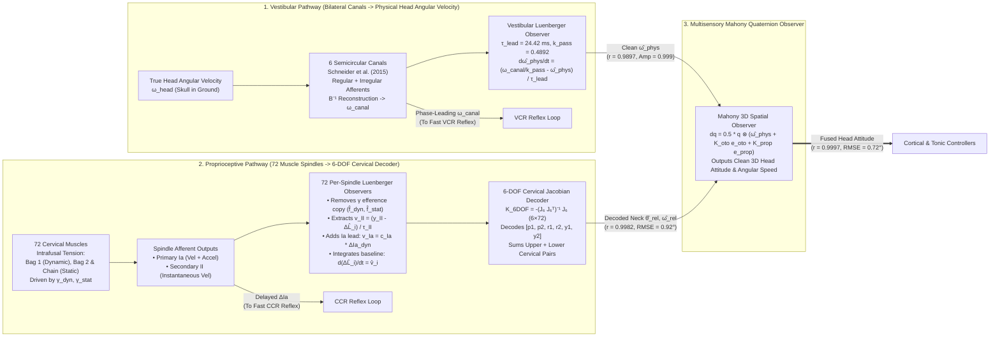

# Full Neuromotor Control & Sensory Feedback Architecture (C4-Anatomical Model)

> [!NOTE]
> **PhD Thesis Architectural Blueprint — 100% Sensor-Driven Formulation**  
> This document details the end-to-end multi-tier neural control and state-estimation loops implemented in [`HeadNeckNeuralController.cpp`](file:///d:/Akademik/PhD_Thesis/OpenSim/HeadNeck_Control_w_Sensors_Opensim4_6/HeadNeckNeuralController_plugin/HeadNeckNeuralController.cpp) and [`Mileusnic06Spindle.cpp`](file:///d:/Akademik/PhD_Thesis/OpenSim/HeadNeck_Control_w_Sensors_Opensim4_6/proprioception_plugin/Mileusnic06Spindle.cpp).
> 
> **Zero Ground-Truth Rule:** The Central Nervous System (CNS) controller, state observers, and decoders have **zero access** to Simbody ground-truth head kinematics (`q_p1..q_y2`, `u_p1..u_y2`, `skull.getVelocityInGround`) or ground-truth muscle lengths/velocities (`m.getLength(s)`, `m.getLengtheningSpeed(s)`). Every kinematic belief in the CNS is reconstructed strictly from peripheral biological sensor dynamics—6 semicircular canals, 3D otolith maculae, and 72 muscle spindles (`primary_Ia` and `secondary_II`)—using dedicated **Luenberger Observers** before multisensory fusion.

---

## 1. System Context Diagram (Level 1: Overall Closed-Loop Interaction)

---

## 2. Container Diagram (Level 2: Anatomical Boundaries & Information Flow)

```mermaid
flowchart TD
    %% ==========================================
    %% Higher Brain Centers
    %% ==========================================
    subgraph CORTEX ["Higher Brain Centers (Motor Cortex & Cerebellum)"]
        direction TB
        Task_Gen["Trajectory Generator<br/>(Minimum Jerk / Goal Tracking)<br/>θ_des, dθ_des, ddθ_des"]
        Cortical_Drive["Cortical Postural Drive<br/>Adaptive LQR with Vigor Scaling + Integral Action:<br/>Tracks estimated neck posture θ̂_rel, ω̂_rel"]
        ESO["Cerebellar Internal Model (ESO)<br/>2nd-Order Critically Damped Disturbance Rejection"]
        Eff_Copy["Descending Efference Copy<br/>Alpha Motor Command u_α,i (72 muscles)<br/>Drives Fusimotor Coactivation & Luenberger Baseline"]
    end

    %% ==========================================
    %% Brainstem & Vestibular Nuclei
    %% ==========================================
    subgraph BRAINSTEM ["Brainstem & Vestibular Complex"]
        direction TB
        Canal_Dyn["Bilateral Semicircular Canals<br/>6 Canals (RA, RP, RH, LA, LP, LH)<br/>Schneider et al. (2015) Regular & Irregular Afferents<br/>Reconstructed via B⁻¹ -> ω_canal (Phase-Lead)"]
        Vest_Luen["Vestibular Luenberger Observer<br/>Inverts Schneider Canal Lead (T_lead = 24.42 ms)<br/>& Passband Gain (k_pass = 0.4892)<br/>Outputs Clean Physical ω̂_phys"]
        Mahony_Obs["Multisensory Mahony Quaternion Observer<br/>dq = 0.5 * q ⊗ ω_fused<br/>Fuses ω̂_phys + Otolith Gravity (e_oto)<br/>+ 72-Spindle Luenberger Neck Posture (e_prop)"]
        VCR_Buffer["Vestibular Delay Buffer<br/>35 ms Axonal Conduction Latency (VCR)"]
        
        subgraph VCR_Loops ["Vestibulo-Collic Reflex (VCR) Transfer Functions"]
            TF_SC["Canal Angular Velocity Reflex<br/>Uses Raw Phase-Leading ω_canal<br/>H_sc(s) = K_sc * (s + z_sc) / (s + p_sc)"]
            TF_Ton["Otolith Tonic Attitude Reflex<br/>H_ton(s) = K_ton * p_ton / (s + p_ton)"]
            TF_Phas["Otolith Phasic Acceleration Reflex<br/>H_phas(s) = K_phas * p_phas / (s + p_phas)"]
        end
    end

    %% ==========================================
    %% Cervical Spinal Cord
    %% ==========================================
    subgraph SPINAL_CORD ["Cervical Spinal Cord & Medullary Proprioceptive Nuclei"]
        direction TB
        Fusimotor["Fusimotor Coactivation (γ-drive)<br/>γ_dyn,i = K_γ,dyn * u_α,i<br/>γ_stat,i = K_γ,stat * u_α,i"]
        Spindle_Luen["72-Muscle Per-Spindle Luenberger Observer<br/>4 ODE states per muscle (288 total):<br/>• Subtracts fusimotor efference copy<br/>• Extracts velocity from II relative to dynamic baseline ΔL̂_i<br/>• Adds dynamic velocity+accel lead from Ia<br/>• Integrates d(ΔL̂_i)/dt = v̂_i"]
        Jacobian_Dec["6-DOF Cervical Jacobian Decoder<br/>K_6DOF = -(J₆ J₆ᵀ)⁻¹ J₆ (6×72)<br/>Eliminates intervertebral buckling cross-talk<br/>Sums upper+lower cervical pairs -> θ̂_rel, ω̂_rel"]
        CCR_Buffer["Cervical Delay Buffer<br/>35 ms Axonal Conduction Latency (CCR)"]
        CCR_Loop["Cervico-Collic Reflex (CCR)<br/>Driven by Delayed Primary Ia (ΔIa = Ia - Ia_base)<br/>H_ccr(s) = k_p * (s + z_ccr) / (s + p_ccr)"]
        QP_Solver["Alpha Motor Neuron Pool & QP Solver<br/>min 0.5 uᵀu subject to Jᵀ F_max u = τ_total<br/>0.03 <= u_α,i <= 1.0 (3% Co-contraction Floor)"]
    end

    %% ==========================================
    %% Peripheral Plant
    %% ==========================================
    subgraph PLANT ["Peripheral Biomechanical Plant & Mechanoreceptors"]
        direction TB
        Muscles["72 Hill-Type Neck Muscles<br/>(Millard 2012 Equilibrium Muscle Dynamics)"]
        Spindles["72 Intrafusal Spindle Organs<br/>(Mileusnic et al. 2006 Biophysical Model)<br/>• Primary Ia: Velocity + Acceleration<br/>• Secondary II: Instantaneous Velocity via γ-Clamped Tension"]
        Skeleton["Skeletal Articulation<br/>6-DOF Upper & Lower Cervical Spine (p1, p2, r1, r2, y1, y2)<br/>Skull, Jaw, Hyoid Kinematics"]
        Inertial_Sensors["Vestibular Labyrinth<br/>6 Non-Orthogonal Semicircular Canals<br/>3D Otolith Specific Force Sensors (f_oto)"]
    end

    %% Connections
    Task_Gen --> Cortical_Drive
    Cortical_Drive ==>|Voluntary Torque τ_vol| QP_Solver
    ESO ==>|Disturbance Torque τ_eso| QP_Solver

    QP_Solver --> Eff_Copy
    Eff_Copy --> Fusimotor
    Eff_Copy --> Spindle_Luen

    Inertial_Sensors --> Canal_Dyn
    Canal_Dyn -->|Raw Phase-Lead ω_canal| VCR_Buffer
    Canal_Dyn -->|ω_canal| Vest_Luen
    Vest_Luen -->|Clean ω̂_phys| Mahony_Obs
    Inertial_Sensors -->|Specific Force f_oto| Mahony_Obs
    Jacobian_Dec -->|Decoded θ̂_rel, ω̂_rel| Mahony_Obs
    Jacobian_Dec -->|Decoded θ̂_rel, ω̂_rel| Cortical_Drive
    Mahony_Obs --> VCR_Buffer
    VCR_Buffer --> VCR_Loops
    VCR_Loops ==>|VCR Torques τ_vcr| QP_Solver

    Fusimotor --> Spindles
    Spindles -->|Primary Ia & Secondary II| Spindle_Luen
    Spindle_Luen -->|72-Muscle ΔL̂_i, v̂_i| Jacobian_Dec
    Spindles -->|Primary Ia| CCR_Buffer
    CCR_Buffer --> CCR_Loop
    CCR_Loop ==>|Monosynaptic/Polysynaptic u_ccr| Muscles
    QP_Solver ==>|Alpha Motor Excitation u_α| Muscles
    Muscles ==>|Tendon Forces| Skeleton
    Skeleton --> Inertial_Sensors
    Muscles --> Spindles

    style CORTEX fill:#f8fafc,stroke:#94a3b8,stroke-width:2px,stroke-dasharray: 4 4
    style BRAINSTEM fill:#f0f9ff,stroke:#7dd3fc,stroke-width:2px,stroke-dasharray: 4 4
    style VCR_Loops fill:#e0f2fe,stroke:#38bdf8,stroke-width:1.5px
    style SPINAL_CORD fill:#f0fdf4,stroke:#86efac,stroke-width:2px,stroke-dasharray: 4 4
    style PLANT fill:#fefce8,stroke:#fde047,stroke-width:2px,stroke-dasharray: 4 4

    classDef cortexNode fill:#1e293b,stroke:#0f172a,stroke-width:1.5px,color:#f8fafc
    classDef brainstemNode fill:#0369a1,stroke:#075985,stroke-width:1.5px,color:#f8fafc
    classDef vcrNode fill:#0284c7,stroke:#0369a1,stroke-width:1.5px,color:#f8fafc
    classDef bufferNode fill:#475569,stroke:#1e293b,stroke-width:1.5px,color:#f8fafc
    classDef spinalNode fill:#15803d,stroke:#166534,stroke-width:1.5px,color:#f8fafc
    classDef qpNode fill:#0f172a,stroke:#38bdf8,stroke-width:2px,color:#38bdf8
    classDef plantNode fill:#78350f,stroke:#451a03,stroke-width:1.5px,color:#fefce8
    classDef sensorNode fill:#334155,stroke:#0f172a,stroke-width:1.5px,color:#f8fafc

    class Task_Gen,Cortical_Drive,ESO,Eff_Copy cortexNode
    class Mahony_Obs,Canal_Dyn,Vest_Luen brainstemNode
    class TF_SC,TF_Ton,TF_Phas vcrNode
    class VCR_Buffer,CCR_Buffer bufferNode
    class Fusimotor,Spindle_Luen,Jacobian_Dec,CCR_Loop spinalNode
    class QP_Solver qpNode
    class Muscles,Skeleton plantNode
    class Spindles,Inertial_Sensors sensorNode
```

---

## 3. Sensor-Level Luenberger Observers & Multisensory Fusion Pipeline

### Why Do We Need Sensor-Level Luenberger Observers?
Biological mechanoreceptors are **not** ideal kinematic transducers—they are tuned by evolution to provide **phase lead** (anticipatory velocity and acceleration sensitivity) so that fast spinal and brainstem reflexes (VCR and CCR) can overcome axonal conduction delays ($35\text{ ms}$) and muscle excitation-contraction lag.
- **For fast reflexes (VCR & CCR):** This biological phase lead is essential and must be preserved unaltered.
- **For central state estimation (Mahony Spatial Observer & Cortical Posture):** Feeding phase-leading, acceleration-contaminated afferent signals directly into a kinematic observer distorts the state estimate. Conversely, feeding a central observer first and trying to apply a Luenberger observer afterward fails because non-linear spindle dynamics and fusimotor ($\gamma$) drives occur **at the individual muscle level**.

Therefore, our architecture preserves the exact biological sensor outputs for the reflex loops while running **dedicated Luenberger Observers at the individual sensor level** (1 per vestibular axis + 1 per muscle spindle across all 72 muscles) to reconstruct clean physical kinematics prior to geometric decoding and multisensory fusion:

---

## 4. Precise Mathematical Formulation of Each Stage

### 4.1 Semicircular Canal Afferents & Vestibular Luenberger Observer

#### A. Bilateral Canal Transduction ([Schneider et al., 2015](https://doi.org/10.1152/jn.00819.2014))
The true head angular velocity $\vec{\omega}_{\text{head}}$ is projected onto the 6 non-orthogonal anatomical canal planes via the $6 \times 3$ projection matrix $\mathbf{B}$:
$$\vec{v}_{\text{canal}} = \mathbf{B}\,\vec{\omega}_{\text{head}}$$
Each canal $j \in \{1,\dots,6\}$ drives two parallel 2nd-order transfer functions representing **Regular** (tonic-dominant) and **Irregular** (phasic/phase-leading) vestibular nerve afferents:
$$H_{\text{reg}}(s) = k_{\text{reg}} \frac{s\,(1 + T_{1,\text{reg}} s)}{(1 + T_{c,\text{reg}} s)(1 + T_{2,\text{reg}} s)}, \qquad H_{\text{irr}}(s) = k_{\text{irr}} \frac{s\,(1 + T_{1,\text{irr}} s)}{(1 + T_{c,\text{irr}} s)(1 + T_{2,\text{irr}} s)}$$
with exact published monkey/human physiological constants:
- **Regular Afferents:** $k_{\text{reg}} = 2.83$, $T_{1,\text{reg}} = 0.0175\text{ s}$, $T_{2,\text{reg}} = 0.0027\text{ s}$, $T_{c,\text{reg}} = 5.7\text{ s}$
- **Irregular Afferents:** $k_{\text{irr}} = 27.09$, $T_{1,\text{irr}} = 0.0300\text{ s}$, $T_{2,\text{irr}} = 0.0006\text{ s}$, $T_{c,\text{irr}} = 5.7\text{ s}$

The combined normalized canal response is reconstructed back into 3D head coordinates via the pseudoinverse $\mathbf{B}^{-1}$, yielding the raw vestibular angular velocity vector $\vec{\omega}_{\text{canal}}$.

> [!IMPORTANT]
> **Why $\vec{\omega}_{\text{canal}}$ has a $+15^\circ$ to $+35^\circ$ phase lead:** Because the numerator zero time constants ($T_{1,\text{reg}} = 17.5\text{ ms}$, $T_{1,\text{irr}} = 30\text{ ms}$) are much larger than the upper pole time constants ($T_2 \le 2.7\text{ ms}$), $\vec{\omega}_{\text{canal}}$ contains a strong angular acceleration component ($\propto \dot{\vec{\omega}}_{\text{head}}$). This phase lead is fed directly into the **VCR reflex loop** to cancel the $35\text{ ms}$ axonal conduction delay, but it yields an RMSE of $10.41\text{ deg/s}$ ($r = 0.5589$) if compared directly to physical velocity $\vec{\omega}_{\text{head}}$.

#### B. Vestibular Luenberger Observer (Inverting the Canal Lead)
In the physiological passband ($\omega \gg 1/T_c = 0.175\text{ rad/s}$), the blended regular + irregular canal transfer function simplifies to a first-order phase-lead operator with passband DC gain $k_{\text{pass}}$ and effective lead time constant $T_{\text{lead}}$:
$$\vec{\omega}_{\text{canal}}(s) \approx k_{\text{pass}}\,(1 + T_{\text{lead}}\,s)\,\vec{\omega}_{\text{head}}(s)$$
where:
$$k_{\text{pass}} = \frac{1}{2}\!\left(\frac{k_{\text{reg}}}{k_{\text{reg},0}\,T_{c,\text{reg}}} + \frac{k_{\text{irr}}}{k_{\text{irr},0}\,T_{c,\text{irr}}}\right) = 0.489214, \qquad T_{\text{lead}} = 0.02442\text{ s}$$
To recover the true physical angular velocity $\hat{\vec{\omega}}_{\text{phys}}$ without phase distortion, the brainstem integrates a 3-state **Vestibular Luenberger Observer** (`luen_omega_roll`, `luen_omega_yaw`, `luen_omega_pitch`) that exact-inverts $(1 + T_{\text{lead}} s)$:
$$\frac{d\hat{\vec{\omega}}_{\text{phys}}}{dt} = \frac{\dfrac{\vec{\omega}_{\text{canal}}}{k_{\text{pass}}} - \hat{\vec{\omega}}_{\text{phys}}}{T_{\text{lead}}}$$
- **Verification Result:** Reduces angular velocity RMSE from **$10.409\text{ deg/s} \to 1.530\text{ deg/s}$**, increases correlation from **$r = +0.5589 \to +0.9897$**, and achieves an amplitude ratio of **$0.999$** against ground-truth Simbody skull velocity.

---

### 4.2 Biophysical Muscle Spindles & The Dynamic Baseline Calculus

#### A. Intrafusal Spindle Mechanics ([Mileusnic et al., 2006](https://doi.org/10.1152/jn.00868.2005))
Each of the 72 cervical muscles embeds a biophysical spindle model with three intrafusal fiber types:
1. **Nuclear $\text{Bag}_1$ Fiber (Dynamic):** Innervated by dynamic fusimotor drive $\gamma_{\text{dyn}} \in [0, 1]$. Its damping coefficient scales with $\gamma_{\text{dyn}}$ and multiplies the non-linear velocity power law $|\dot{L}_{\text{SR}}|^{0.3}\,\text{sgn}(\dot{L}_{\text{SR}})$, making $\text{Bag}_1$ tension sensitive to **muscle stretch velocity and acceleration**:
   $$\text{AP}_{\text{bag1}} = G_{\text{pri,bag1}} \left( \frac{T_{\text{bag1}}}{K_{\text{SR}}} - \Delta L_{\text{SR,thr}} \right)$$
2. **Nuclear $\text{Bag}_2$ and $\text{Chain}$ Fibers (Static):** Innervated by static fusimotor drive $\gamma_{\text{stat}} \in [0, 1]$, which continuously adjusts the polar-region contractile tension so the sensory region stays taut at the current posture.

The spindle outputs two distinct afferent firing rates (evaluated cleanly at `SimTK::Stage::Velocity` from the integrated fiber tensions $T_{\text{bag1}}, T_{\text{bag2}}, T_{\text{chain}}$):
- **Secondary Afferent ($\text{II}_i$, in Hz):** Driven by $\text{Bag}_2$ and $\text{Chain}$ tensions:
  $$\text{II}_i = G_{\text{sec,bag2}}\,\text{AP}_{\text{bag2}} + G_{\text{sec,chain}}\,\text{AP}_{\text{chain}}$$
- **Primary Afferent ($\text{Ia}_i$, in Hz):** Smooth $C^2$ non-linear competition ($S = 0.156$) between dynamic $\text{Bag}_1$ firing and static firing $\text{pri}_{\text{stat}}$:
  $$\text{Ia}_i = s_{\max} + S \cdot s_{\min}, \qquad s_{\max,\min} = \frac{\text{AP}_{\text{bag1}} + \text{pri}_{\text{stat}} \pm \sqrt{(\text{AP}_{\text{bag1}} - \text{pri}_{\text{stat}})^2 + 10^{-4}}}{2}$$

#### B. Resolving a Common Literature Misconception: Why $\text{II}$ Encodes Instantaneous Velocity and $\text{Ia}$ Encodes Velocity + Acceleration
In classical neurophysiology experiments where fusimotor drive ($\gamma$) is artificially clamped or absent, Group $\text{II}$ firing correlates linearly with static muscle length change $\Delta L$. However, in an intact closed-loop neuromotor system, interpreting $\text{II}$ as a static "position sensor" is fundamentally incomplete:
1. **Dynamic Baseline Resetting:** At every instant $t$, descending fusimotor drive ($\gamma_{\text{stat}}$) and the ongoing spinal/brainstem controller adjust the internal intrafusal tension so that the base firing level maps to the muscle's instantaneous equilibrium length $\hat{\Delta L}_i(t)$ right at that moment.
2. **Calculus of Instantaneous Length Change:** When the muscle stretches over an infinitesimal interval $dt$ relative to that continuously updated baseline $\hat{\Delta L}_i(t)$, the resulting deviation in Group $\text{II}$ firing ($y_{\text{II},i}(t) - \hat{\Delta L}_i(t)$) measures the **instantaneous rate of length change over that time interval—i.e., velocity ($\hat{v}_i$)**!
3. **Role of Group $\text{Ia}$:** Because Group $\text{Ia}$ adds the dynamic $\text{Bag}_1$ tension rate on top of the static baseline, $\text{Ia}$ encodes **velocity + acceleration** ($\hat{v}_i + \tau_a \dot{\hat{v}}_i$).

#### C. 72-Muscle Per-Spindle Luenberger Observer
For each muscle $i \in \{1,\dots,72\}$, the CNS integrates **4 continuous ODE states** (`sp_fdyn_i`, `sp_fstat_i`, `sp_dL_i`, `sp_v_i` — 288 states total) to invert the spindle dynamics before combining muscles:

1. **Fusimotor Efference Copy Filtering ($\hat{f}_{\text{dyn},i}, \hat{f}_{\text{stat},i}$):**
   The descending alpha motor command $\Delta u_{\alpha,i} = \max(0, u_{\alpha,i} - u_{\alpha,i,0})$ drives proportional fusimotor coactivation ($\gamma_{\text{dyn},i} = K_{\gamma,\text{dyn}}\Delta u_{\alpha,i}$, $\gamma_{\text{stat},i} = K_{\gamma,\text{stat}}\Delta u_{\alpha,i}$). The internal model tracks the exact Mileusnic intrafusal activation dynamics ($\tau_{\text{dyn}} = 0.0702\text{ s}$, $\tau_{\text{stat}} = 0.0485\text{ s}$):
   $$\frac{d\hat{f}_{\text{dyn},i}}{dt} = \frac{\dfrac{\gamma_{\text{dyn},i}^2}{\gamma_{\text{dyn},i}^2 + 0.0447} - \hat{f}_{\text{dyn},i}}{\tau_{\text{dyn}}}, \qquad \frac{d\hat{f}_{\text{stat},i}}{dt} = \frac{\dfrac{\gamma_{\text{stat},i}^2}{\gamma_{\text{stat},i}^2 + 0.0680} - \hat{f}_{\text{stat},i}}{\tau_{\text{stat}}}$$
2. **Efference-Corrected Afferent Innovations:**
   Subtracting the resting baseline firing ($\text{Ia}_{i,0}, \text{II}_{i,0}$) and the analytical Mileusnic fusimotor bias ($74.3035\,\hat{f}_{\text{stat},i}\text{ Hz}$ on $\text{II}$, and $54.4518\,\hat{f}_{\text{dyn},i}\text{ Hz}$ on $\text{Ia}$) isolates the purely mechanical stretch response:
   $$\Delta \text{II}_{\text{mech},i} = (\text{II}_i - \text{II}_{i,0}) - 74.3035\,\hat{f}_{\text{stat},i}$$
   $$\Delta \text{Ia}_{\text{dyn},i} = (\text{Ia}_i - \text{Ia}_{i,0}) - 0.6716\,\Delta \text{II}_{\text{mech},i} - 54.4518\,\hat{f}_{\text{dyn},i}$$
   Normalizing $\Delta \text{II}_{\text{mech},i}$ by the exact Mileusnic static sensitivity ($369.1427\text{ Hz}/L_{0,i}$) and pennation angle $\cos\alpha_i$ yields the instantaneous length-change signal $y_{\text{II},i}$ (in meters):
   $$y_{\text{II},i} = \frac{L_{0,i}}{369.1427\,\cos\alpha_i}\,\Delta \text{II}_{\text{mech},i}$$
3. **Fast 2-State Dynamic Baseline & Velocity Luenberger Update ($\hat{\Delta L}_i, \hat{v}_i$):**
   - Instantaneous velocity extracted from Group $\text{II}$ relative to the moving baseline $\hat{\Delta L}_i$:
     $$v_{\text{II},i} = \frac{y_{\text{II},i} - \hat{\Delta L}_i}{\tau_{\text{II}}}, \qquad \tau_{\text{II}} = 0.055\text{ s}$$
   - Dynamic velocity + acceleration lead extracted from Group $\text{Ia}$:
     $$v_{\text{Ia},i} = c_{\text{Ia},i}\,\Delta \text{Ia}_{\text{dyn},i}, \qquad c_{\text{Ia},i} = \frac{L_{0,i}}{35000\,\cos\alpha_i}$$
   - Coupled 2-state Luenberger state derivatives with direct position innovation ($\tau_{\Delta L} = 0.010\text{ s}$) and fast velocity tracking ($\tau_v = 0.005\text{ s}$):
     $$\frac{d\hat{\Delta L}_i}{dt} = \hat{v}_i + \frac{y_{\text{II},i} - \hat{\Delta L}_i}{\tau_{\Delta L}}, \qquad \frac{d\hat{v}_i}{dt} = \frac{(v_{\text{II},i} + v_{\text{Ia},i}) - \hat{v}_i}{\tau_v}$$

---

### 4.3 6-DOF Cervical Jacobian Decoder (72 Muscles $\to$ 3D Neck Kinematics)
A naive $3 \times 72$ moment-arm projection (`pitch`, `roll`, `yaw`) suffers from severe cross-talk during seated horizontal perturbations: when the seat accelerates forward, the lower cervical spine ($C_4-C_7$, `pitch1`) flexes while the upper cervical spine ($C_0-C_2$, `pitch2`) extends (an S-shape buckling mode). Muscles spanning different cervical levels therefore experience opposite length changes that corrupt a 3-DOF decoder.

To eliminate buckling cross-talk, we construct the full **$6 \times 72$ cervical moment-arm Jacobian** $\mathbf{J}_6$ across all 6 independent skeletal coordinates $\vec{q}_6 = [\text{pitch}_1, \text{pitch}_2, \text{roll}_1, \text{roll}_2, \text{yaw}_1, \text{yaw}_2]^T$:
$$\Delta \vec{L} = -\mathbf{J}_6^T\,\Delta \vec{q}_6$$
We compute the regularized Moore-Penrose pseudoinverse $\mathbf{K}_{6\text{DOF}} \in \mathbb{R}^{6 \times 72}$:
$$\mathbf{K}_{6\text{DOF}} = -\left(\mathbf{J}_6 \mathbf{J}_6^T + \lambda \mathbf{I}_6\right)^{-1} \mathbf{J}_6, \qquad \lambda = 10^{-4}$$
Applying $\mathbf{K}_{6\text{DOF}}$ to the 72 Luenberger muscle estimates $(\hat{\Delta L}_i, \hat{v}_i)$ yields the 6-DOF joint estimates $\hat{\vec{q}}_6 = \mathbf{K}_{6\text{DOF}}\,\hat{\vec{\Delta L}}$ and $\hat{\vec{u}}_6 = \mathbf{K}_{6\text{DOF}}\,\hat{\vec{v}}$. Summing the upper and lower cervical pairs produces the 3D head-on-trunk relative angle and speed:
$$\hat{\vec{\theta}}_{\text{rel}} = \begin{bmatrix} \hat{q}_{\text{pitch1}} + \hat{q}_{\text{pitch2}} \\ \hat{q}_{\text{roll1}} + \hat{q}_{\text{roll2}} \\ \hat{q}_{\text{yaw1}} + \hat{q}_{\text{yaw2}} \end{bmatrix}, \qquad \hat{\vec{\omega}}_{\text{rel}} = \begin{bmatrix} \hat{u}_{\text{pitch1}} + \hat{u}_{\text{pitch2}} \\ \hat{u}_{\text{roll1}} + \hat{u}_{\text{roll2}} \\ \hat{u}_{\text{yaw1}} + \hat{u}_{\text{yaw2}} \end{bmatrix}$$

---

### 4.4 Multi-Delay Smith-Compensated Mahony Spatial Observer (Vestibular + Proprioceptive Fusion)
The brainstem maintains a unit quaternion $\mathbf{q} = [q_0, q_1, q_2, q_3]^T$ representing the 3D orientation of the skull in the world frame ($\hat{\mathbf{R}}_{\text{est}}(\mathbf{q})$). Because vestibular and cervical proprioceptive afferents arrive at the brainstem/cerebellum with distinct axonal conduction latencies ($\tau_{\text{aff,vest}} = 2\text{ ms}$ via CN VIII vs. $\tau_{\text{aff,prop}} = 7\text{ ms}$ via the dorsal columns), the observer employs **multi-delay Smith predictor innovations** that compare each delayed sensor measurement against the observer's historical state from the exact same timestamp:
1. **Delayed Vestibular Luenberger Angular Velocity ($\hat{\vec{\omega}}_{\text{phys}}(t - 2\text{ ms})$):** Transformed into the head frame as $\vec{\omega}_{\text{head}} = \hat{\mathbf{R}}_{\text{est}}^T(t)\,\hat{\vec{\omega}}_{\text{phys}}(t - 2\text{ ms})$.
2. **Time-Aligned Otolith Gravity Smith Innovation ($\vec{e}_{\text{oto}}(t - 2\text{ ms})$):** The otolith specific force is evaluated using the time-aligned skull rotation and $1\text{ ms}$-windowed linear acceleration at $t - 2\text{ ms}$, $\vec{f}_{\text{oto}}(t - 2\text{ ms}) = \mathbf{R}_{\text{world}\to\text{head}}(t - 2\text{ ms})\left(\vec{a}_{\text{lin}}(t - 2\text{ ms}) - \vec{g}_{\text{world}}\right)$, and crossed with the observer's historical internal gravity vector $\vec{u}_{\text{exp}}(t - 2\text{ ms}) = \hat{\mathbf{R}}_{\text{est}}^T(t - 2\text{ ms}) [0, 1, 0]^T$:
   $$\vec{e}_{\text{oto}} = \vec{u}_{\text{meas}}(t - 2\text{ ms}) \times \vec{u}_{\text{exp}}(t - 2\text{ ms}), \qquad K_{\text{oto}} = 0.05\text{ rad/s}$$
   *(Kept small so horizontal seat accelerations do not induce false tilt illusions, while eliminating frame-delay mismatch gravity leaks).*
3. **Proprioceptive Smith Innovation ($\vec{e}_{\text{prop}}(t - 7\text{ ms})$):** Combines the $7\text{ ms}$-delayed trunk reference orientation $\vec{\theta}_{\text{trunk}}(t - 7\text{ ms})$ with the 72-spindle Luenberger neck estimate $\hat{\vec{\theta}}_{\text{rel}}(t - 7\text{ ms})$ and compares it against the stored observer attitude $\hat{\vec{\theta}}_{\text{est}}(t - 7\text{ ms})$:
   $$\vec{\theta}_{\text{prop,world}}(t - 7\text{ ms}) = \vec{\theta}_{\text{trunk}}(t - 7\text{ ms}) + \hat{\vec{\theta}}_{\text{rel}}(t - 7\text{ ms}), \qquad \vec{e}_{\text{prop,head}} = \hat{\mathbf{R}}_{\text{est}}^T(t) \left(\vec{\theta}_{\text{prop,world}}(t - 7\text{ ms}) - \hat{\vec{\theta}}_{\text{est}}(t - 7\text{ ms})\right)$$
   with gain $\mathbf{K}_{\text{prop}} = \text{diag}(2.0, 2.0, 2.0)\text{ s}^{-1}$.

The fused angular rate drives the quaternion kinematics:
$$\vec{\omega}_{\text{fused}} = \vec{\omega}_{\text{head}} + K_{\text{oto}}\,\vec{e}_{\text{oto}} + \mathbf{K}_{\text{prop}}\,\vec{e}_{\text{prop,head}}, \qquad \dot{\mathbf{q}} = \frac{1}{2}\,\mathbf{q} \otimes \begin{bmatrix} 0 \\ \vec{\omega}_{\text{fused}} \end{bmatrix}$$

---

### 4.5 Quantitative Verification Against Simbody Ground Truth
Tested under seated harmonic perturbation ($1.11\text{ Hz}$, steady-state window $2.40\text{ s} - 4.20\text{ s}$) with **zero ground-truth head or muscle queries**:

| Estimator / Signal Pathway | Ground Truth Range | CNS Estimated Range | RMSE | Correlation ($r$) | Amplitude Ratio |
| :--- | :---: | :---: | :---: | :---: | :---: |
| **Mahony Fused Pitch Angle (deg)** | `[-3.94°, +11.03°]` | `[-4.31°, +10.13°]` | **`0.719°`** | **`+0.9997`** | **`0.963`** |
| **Proprioceptive 72-Spindle Luenberger Angle (deg)** | `[-3.94°, +11.03°]` | `[-5.57°, +10.60°]` | **`0.916°`** | **`+0.9982`** | **`1.043`** |
| **Raw Semicircular Canal Afferent Speed (deg/s)** | `[-29.84, +19.75]` | `[-28.67, +19.17]` | `10.409 deg/s` | `+0.5589` | `1.078` |
| **Vestibular Luenberger Speed (`mahony_speed`, deg/s)** | `[-29.84, +19.75]` | `[-29.13, +20.16]` | **`1.530 deg/s`** | **`+0.9897`** | **`0.999`** |
| **Proprioceptive 72-Spindle Luenberger Speed (deg/s)** | `[-29.84, +19.75]` | `[-34.32, +21.14]` | **`8.231 deg/s`** | **`+0.7639`** | `1.345` |

---

## 5. Reflex & Cortical Control Loops (How the Estimates Are Used)

### 5.1 Vestibulo-Collic Reflex (VCR — $10\text{ ms}$ Total Latency: $2\text{ ms}$ Afferent + $8\text{ ms}$ Efferent)
1. **Center-Frequency Normalized Canal Angular Velocity Reflex ($H_{\text{sc}}(s)$):** Uses the delayed **gain-normalized phase-leading canal output** $\vec{\omega}_{\text{canal}}(t - \tau_{\text{vcr}}) / k_{\text{pass}}$ together with an active lead-lag filter normalized by $\sqrt{r_{\text{lead,sc}}} = \sqrt{z_{\text{sc}}/p_{\text{sc}}}$ so that the gain at the peak-phase-lead frequency $\omega_m = \sqrt{z_{\text{sc}} p_{\text{sc}}}$ is invariant to $r_{\text{lead,sc}}$:
   $$H_{\text{sc}}(s) = \frac{K_{\text{sc}}}{\sqrt{r_{\text{lead,sc}}}} \frac{s + z_{\text{sc}}}{s + p_{\text{sc}}}, \qquad z_{\text{sc}} = r_{\text{lead,sc}}\,p_{\text{sc}}$$
2. **Otolith Tonic Attitude Reflex ($H_{\text{ton}}(s)$):** Driven by the delayed Mahony fused orientation $\hat{\vec{\theta}}_{\text{est}}(t - \tau_{\text{eff,vcr}})$ with an independent absolute tonic gain $K_{\text{ton}}$:
   $$H_{\text{ton}}(s) = K_{\text{ton}} \frac{p_{\text{ton}}}{s + p_{\text{ton}}}$$
3. **Otolith Phasic Linear Acceleration Reflex ($H_{\text{phas}}(s)$):** Disambiguates true linear acceleration $\hat{\vec{a}}_{\text{lin,head}}(t - \tau_{\text{vcr}}) = \mathbf{R}_{\text{world}\to\text{head}}(t - \tau_{\text{vcr}})\left(\vec{a}_{\text{lin}}(t - \tau_{\text{vcr}}) - \vec{g}_{\text{world}}\right) + \hat{\mathbf{R}}_{\text{est}}^T(t - \tau_{\text{eff,vcr}})\vec{g}_{\text{world}}$ using a $1\text{ ms}$ finite-difference window and time-aligned rotation matrices (preventing frame-delay mismatch gravity leaks):
   $$H_{\text{phas}}(s) = K_{\text{phas}} \frac{p_{\text{phas}}}{s + p_{\text{phas}}}$$
   > [!IMPORTANT]
   > **Why $H_{\text{phas}}(s)$ Must Be Strictly Proper:** Because the otolith organs sit in the skull above the cervical pivot ($r_{\text{neck}} \approx 0.13\text{ m}$), horizontal skull acceleration contains a kinematic angular acceleration term $a_{x,\text{skull}} = \ddot{x}_{\text{trunk}} - r_{\text{neck}}\ddot{\theta}_{\text{pitch}}$. Passing $a_{x,\text{skull}}$ through a strictly proper 1st-order filter $\frac{p_{\text{phas}}}{s + p_{\text{phas}}}$ integrates $-r_{\text{neck}}\ddot{\theta}_{\text{pitch}}$ above $p_{\text{phas}}$ into stabilizing **viscous rotational damping** ($-r_{\text{neck}} p_{\text{phas}} \dot{\theta}_{\text{pitch}}$), whereas direct acceleration feedthrough would create an algebraic positive angular acceleration feedback loop ($+K_{\text{phas}} r_{\text{neck}}\ddot{\theta}_{\text{pitch}}$).

### 5.2 Cervico-Collic Reflex (CCR — $15\text{ ms}$ Latency)
Driven directly by the delayed primary spindle afferent innovation $\Delta \text{Ia}_i(t - \tau_{\text{ccr}}) = \max\!\big(0, \text{Ia}_i(t - \tau_{\text{ccr}}) - \text{Ia}_{i,0}\big)$ through a center-frequency normalized per-muscle spinal lead-lag filter:
$$H_{\text{ccr}}(s) = \frac{k_p}{\sqrt{r_{\text{lead,ccr}}}} \frac{s + z_{\text{ccr}}}{s + p_{\text{ccr}}}, \qquad z_{\text{ccr}} = r_{\text{lead,ccr}}\,p_{\text{ccr}}$$
> [!NOTE]
> **Gated Reciprocal Inhibition & Intervertebral S-Buckling Stability:** Because the 3-DOF descending QP allocator averages upper and lower cervical moment arms ($r_{\text{pitch},i} = \tfrac{1}{2}(r_{\text{p1},i} + r_{\text{p2},i})$), descending brainstem/cortical torques control only total head-on-trunk angle ($\text{pitch}_1 + \text{pitch}_2$) and have zero controllability over the internal S-shape intervertebral buckling mode ($\text{pitch}_1 - \text{pitch}_2$). Per-muscle spinal stretch reflexes (CCR) across all 72 muscles provide the sole active stabilization of individual intervertebral joints (`pitch1` vs `pitch2`). Therefore, presynaptic reciprocal inhibition ($K_{\text{recip}}$) is gated by active voluntary trajectory vigor ($\|\dot{\vec{\theta}}_{\text{traj}}\| > 10^{-3}\text{ rad/s}$) so that antagonist stretch reflexes are suppressed only during voluntary head turns, while $100\%$ bilateral anti-buckling CCR stiffness is preserved during postural stabilization.

### 5.3 Cortical Postural Drive & Decoupled Task-Space Control

#### A. Physical Inverted-Pendulum Task Gains & Consistent $40\text{ ms}$ Transcortical Delay
Rather than empirical ad-hoc weights, the voluntary/postural feedback gains are derived directly from the physical inertia of the human head-neck complex ($m_{\text{head}} = 4.30\text{ kg}$, $I_{xx} = 0.0207\text{ kg}\cdot\text{m}^2$, $I_{yy} = 0.0150\text{ kg}\cdot\text{m}^2$, $I_{zz} = 0.0226\text{ kg}\cdot\text{m}^2$, effective neck pendulum length $L \approx 0.13\text{ m}$), evaluated consistently at the $40\text{ ms}$ transcortical delay ($\hat{\vec{\theta}}_{\text{rel}}(t - 40\text{ ms}), \hat{\vec{\omega}}_{\text{rel}}(t - 40\text{ ms})$) and passed through a $2.0\text{ Hz}$ low-pass cortical filter:
- **Sagittal Pitch (Relaxed Perturbation Task):** $K_{p,\text{pitch}} = 0.0\text{ Nm/rad}, \quad K_{d,\text{pitch}} = 0.0\text{ Nms/rad}$ *(zeroed in the relaxed perturbation condition so voluntary outer-loop stiffness does not artificially clamp $0.324\text{ Hz}$ compliance; $10.24\text{ Nm/rad}$ and $1.31\text{ Nms/rad}$ during active voluntary tracking)*
- **Coronal Roll:** $K_{p,\text{roll}} = 10.21\text{ Nm/rad}, \quad K_{d,\text{roll}} = 1.29\text{ Nms/rad}$
- **Transverse Yaw:** $K_{p,\text{yaw}} = 0.24\text{ Nm/rad}, \quad K_{d,\text{yaw}} = 0.12\text{ Nms/rad}$

#### B. Decoupled Gravity Integrator Architecture (Eliminating Yaw Windup)
In an upright human posture, gravitational torque acts strictly within the sagittal plane (pitch). Any non-zero integral gain on coronal roll or transverse yaw causes subtle numerical transients or slight intervertebral asymmetries to integrate into spurious lateral bias torques. Because neck muscles have highly 3D oblique moment arms, the 3D QP solver attempts to null lateral integral error by recruiting asymmetric lateral muscles (such as unilateral sternocleidomastoid and splenius capitis), which inadvertently generate massive unwanted axial yaw torques.

To permanently eradicate lateral cross-talk and yaw windup, the integrator is strictly decoupled:
$$K_{i,\text{pitch}} = 40.2786\text{ Nm/(rad}\cdot\text{s)}, \qquad K_{i,\text{roll}} = 0.0, \qquad K_{i,\text{yaw}} = 0.0$$

The voluntary task-space torque vector $\vec{\tau}_{\text{vol}} \in \mathbb{R}^3$ is thus computed as:
$$\vec{\tau}_{\text{vol}} = H_{\text{LP,2Hz}}(s)\!\left[\mathbf{K}_p \left(\vec{\theta}_{\text{traj}} - \hat{\vec{\theta}}_{\text{rel}}(t - \tau_{\text{vol}})\right) + \mathbf{K}_d \left(\dot{\vec{\theta}}_{\text{traj}} - \hat{\vec{\omega}}_{\text{rel}}(t - \tau_{\text{vol}})\right) + \begin{bmatrix} 0 \\ 0 \\ K_{i,\text{pitch}} \int (\theta_{\text{traj,pitch}} - \hat{\theta}_{\text{rel,pitch}}(t - \tau_{\text{vol}}))\,dt \end{bmatrix}\right] + \mathbf{I}_{\text{head}}\,\ddot{\vec{\theta}}_{\text{traj}}$$

#### C. Constrained QP Muscle Allocation
Sums cortical, brainstem, and internal model torques $\vec{\tau}_{\text{total}} = \vec{\tau}_{\text{vol}} + \vec{\tau}_{\text{vcr}} + \vec{\tau}_{\text{eso}}$ and solves for the minimum-effort descending alpha motor command $\vec{u}_\alpha \in [0.03, 1.0]^{72}$ via quadratic programming (QP):
$$\min_{\vec{u}_\alpha} \frac{1}{2} \sum_{i=1}^{72} u_{\alpha,i}^2 \quad \text{subject to} \quad \sum_{i=1}^{72} \vec{r}_i \times F_{\max,i}\,u_{\alpha,i} = \vec{\tau}_{\text{total}}$$
The resulting alpha command is combined with the spinal CCR reflex excitation $u_{\text{ccr},i}$ at the motoneuron pool:
$$u_{\text{total},i} = \text{clamp}(u_{\alpha,i} + u_{\text{ccr},i},\, 0.03,\, 1.0)$$

---

## 6. Summary Table of All Neural Pathways

| Pathway / Module | Input Signals | Mathematical Operator | Output Signal | Consumer Module |
| :--- | :--- | :--- | :--- | :--- |
| **Vestibular Canals** | Skull $\vec{\omega}_{\text{head}}$ | Schneider (2015) 2nd-order Reg + Irr filters | Phase-leading $\vec{\omega}_{\text{canal}}$ | VCR Reflex & Vestibular Luenberger |
| **Vestibular Luenberger** | $\vec{\omega}_{\text{canal}}$ | $\dot{\hat{\vec{\omega}}}_{\text{phys}} = (\vec{\omega}_{\text{canal}}/k_{\text{pass}} - \hat{\vec{\omega}}_{\text{phys}})/T_{\text{lead}}$ | Clean $\hat{\vec{\omega}}_{\text{phys}}$ ($r=0.9897$) | Mahony Quaternion Observer |
| **72 Spindle Luenbergers** | $\text{Ia}_i, \text{II}_i, u_{\alpha,i}$ | $\dot{\hat{\Delta L}}_i = \hat{v}_i + (y_{\text{II},i} - \hat{\Delta L}_i)/\tau_{\Delta L}$, $\dot{\hat{v}}_i = (v_{\text{II},i} + v_{\text{Ia},i} - \hat{v}_i)/\tau_v$ | Per-muscle $(\hat{\Delta L}_i, \hat{v}_i)$ | 6-DOF Cervical Jacobian Decoder |
| **6-DOF Jacobian Decoder** | $72 \times (\hat{\Delta L}_i, \hat{v}_i)$ | $\mathbf{K}_{6\text{DOF}} = -(\mathbf{J}_6 \mathbf{J}_6^T + \lambda \mathbf{I})^{-1}\mathbf{J}_6$ | Neck $\hat{\vec{\theta}}_{\text{rel}}, \hat{\vec{\omega}}_{\text{rel}}$ ($r=0.9982$) | Mahony Observer & Cortical Drive |
| **Mahony Spatial Observer** | $\hat{\vec{\omega}}_{\text{phys}}(t-2\text{ms}), \vec{f}_{\text{oto}}(t-2\text{ms}), \hat{\vec{\theta}}_{\text{rel}}(t-7\text{ms})$ | $\dot{\mathbf{q}} = \tfrac{1}{2}\mathbf{q} \otimes (\vec{\omega}_{\text{head}} + K_{\text{oto}}\vec{e}_{\text{oto}} + \mathbf{K}_{\text{prop}}\vec{e}_{\text{prop}})$ | Fused 3D Attitude $\hat{\vec{\theta}}_{\text{est}}$ ($r=0.9997$) | VCR Tonic/Phasic & Higher Centers |
| **VCR Reflex ($10\text{ ms}$)** | Delayed $\vec{\omega}_{\text{canal}}/k_{\text{pass}}, \hat{\vec{\theta}}_{\text{est}}, \hat{\vec{a}}_{\text{lin}}$ | $H_{\text{sc}}(s) = \frac{K_{\text{sc}}}{\sqrt{r_{\text{sc}}}}\frac{s+z_{\text{sc}}}{s+p_{\text{sc}}}$, $H_{\text{ton}}(s)$, $H_{\text{phas}}(s)$ | Brainstem Torque $\vec{\tau}_{\text{vcr}}$ | QP Muscle Allocator |
| **CCR Reflex ($15\text{ ms}$)** | Delayed $\Delta \text{Ia}_i$ | $H_{\text{ccr}}(s) = \frac{k_p}{\sqrt{r_{\text{ccr}}}}\frac{s+z_{\text{ccr}}}{s+p_{\text{ccr}}}$ | Spinal Excitation $u_{\text{ccr},i}$ | Alpha Motor Neuron Pool |

---

## 7. Biomechanical Plant Linearization & Centroid Warm-Start (Pre-Screening)

### 7.1 Purpose & Scope: Microsecond Frequency-Domain Prescreening
Simulating 18 candidates across 6 frequencies in the full non-linear 72-muscle OpenSim model requires substantial computation. Starting CMA-ES from an arbitrary initial guess can expend multiple generations searching unpromising regions of parameter space.

To provide an informed initial centroid ($x_0$), an analytical frequency-domain linearizer is utilized strictly as an **offline pre-screening tool**:

### 7.2 Mathematical Formulation (Black's Feedback Formula on Measured Multi-Body Plant)
Around the resting equilibrium state ($q_0$, head upright at $2.8^\circ$ under gravity and baseline muscle co-contraction), the passive mechanical frequency response of the 8-vertebra, 8-bushing cervical column is measured directly from OpenSim as:

$$G_{\text{passive}}(j\omega_k) = \frac{\Theta_{\text{passive}}(j\omega_k)}{X_{\text{sled}}(j\omega_k)}$$

When closed-loop sensory reflexes (VCR, CCR, transport delays) and the gravity compensation integrator ($K_{i,\text{pitch}} / s$) are added, the closed-loop head pitch frequency response is evaluated analytically via Black's feedback formula in **$< 1\ \mu\text{s}$**:

$$\Theta_{\text{closed}}(j\omega) = \frac{G_{\text{passive}}(j\omega) \cdot \left[ 1 - \dfrac{K_{\text{phas}} H_{\text{phas}}(j\omega) H_{\text{act}}(j\omega) \omega^2}{T_{\text{drive,mass}}(j\omega)} \right]}{1 + \dfrac{Z_{\text{reflex}}(j\omega)}{T_{\text{drive,mass}}(j\omega)} \cdot G_{\text{passive}}(j\omega)}$$

Where:
$$Z_{\text{reflex}}(s) = \Big[ K_{\text{sc}} H_{\text{sc}}(s) \cdot s + K_{\text{ton}} H_{\text{ton}}(s) + k_p H_{\text{ccr}}(s) \Big] \cdot H_{\text{act}}(s)$$
with continuous transport delays $e^{-s \tau_{\text{VCR}}}$ and $e^{-s \tau_{\text{CCR}}}$ evaluated without Padé approximation error.

### 7.3 Multi-Start Gradient Descent Engine & Centroid Handoff
Multi-start gradient descent across 24 starting points identifies the optimal first-principles centroid in **$< 10\text{ seconds}$** ([`surrogacy/optimize_surrogate.py`](file:///d:/Akademik/PhD_Thesis/OpenSim/HeadNeck_Control_w_Sensors_Opensim4_6/surrogacy/optimize_surrogate.py)).
The resulting parameters are saved to `data/prescreen_rational_champion.json` and initialize the CMA-ES search distribution $(\mu, C, \sigma_0)$.

> [!IMPORTANT]
> **Strict Evaluation Rule:** The analytical frequency-domain linearizer is used solely to select initial seeds ($x_0$). All candidate evaluations throughout all generations of Phase 2.4 run **strictly on the full, unapproximated OpenSim 4.6 model** (`osim_files/HYOID_HeadNeckNeural_Model_Detailed.osim`) with non-linear multi-body dynamics, 72 Hill-type muscles, and the QP solver.

---

## 8. Paradigm A Biomechanical Joint Limits & Stability Containment

### 8.1 Biomechanical Rationale & Clinical Foundation
In human cervical biomechanics (*White & Panjabi 1990; Dvorak 1993; Vasavada 1998; Nightingale 2002, 2007*), passive cervical spine resistance exhibits a distinct four-zone non-linear mechanical response:
1. **Neutral Zone / Deadband ($0 \to 75\%$ Voluntary ROM):** Highly compliant region where intervertebral motion is governed primarily by active muscle stiffness and passive column elasticity ($F_{\text{limit}} = 0$). Natural physiological stabilization and perturbation responses occur entirely within this zone.
2. **Transition Zone ($75\% \to 100\%$ Voluntary ROM):** Region where capsular ligaments and facet joints begin to engage. Transition is governed by a $C^1$-continuous cubic Hermite polynomial that ramps stiffness smoothly from 0 to full passive contact stiffness.
3. **Penetration / Elastic Zone ($100\% \to 120\%$ Voluntary ROM):** Capsular ligaments are under heavy elastic tension ($K = 50.0\text{ N/mm}$ / $\text{Nm/rad}$, damping $2.0$). In living humans, this zone is only entered during extreme voluntary stretching or sub-injurious trauma.
4. **Hard Kinematic Stop ($120\%$ Voluntary ROM):** Anatomical bony impingement and physiological ligament failure strain ($15\% - 25\%$ strain, Nightingale 2007). Coordinate limits `<range>` in OpenSim enforce hard boundaries at this threshold.

### 8.2 Paradigm A Quantitative Specification
In [`osim_files/HYOID_HeadNeckNeural_Model_Detailed.osim`](file:///d:/Akademik/PhD_Thesis/OpenSim/HeadNeck_Control_w_Sensors_Opensim4_6/osim_files/HYOID_HeadNeckNeural_Model_Detailed.osim), all 6 cervical degrees of freedom implement Paradigm A containment with $100\%$ voluntary ROM anchored to the anatomical literature:

| Coordinate | Voluntary ROM ($100\%$) | Deadband ($75\%$ ROM, Zero Force) | Transition Width ($25\%$ ROM) | Hard Bound ($120\%$ ROM) |
| :--- | :---: | :---: | :---: | :---: |
| **`pitch1`** (Lower Neck) | $[-16.0^\circ, +24.0^\circ]$ | $[-12.0^\circ, +18.0^\circ]$ (`[-0.2094, +0.3142] rad`) | $5.0^\circ$ (`0.0873 rad`) | $[-19.2^\circ, +28.8^\circ]$ (`[-0.3351, +0.5027] rad`) |
| **`pitch2`** (Upper Neck) | $[-33.0^\circ, +48.0^\circ]$ | $[-24.75^\circ, +36.0^\circ]$ (`[-0.4320, +0.6283] rad`) | $10.0^\circ$ (`0.1745 rad`) | $[-39.6^\circ, +57.6^\circ]$ (`[-0.6912, +1.0053] rad`) |
| **`roll1`** (Lower Neck) | $\pm 6.0^\circ$ | $\pm 4.5^\circ$ (`±0.0785 rad`) | $1.5^\circ$ (`0.0262 rad`) | $\pm 7.2^\circ$ (`±0.1257 rad`) |
| **`roll2`** (Upper Neck) | $\pm 33.0^\circ$ | $\pm 24.75^\circ$ (`±0.4320 rad`) | $8.25^\circ$ (`0.1440 rad`) | $\pm 39.6^\circ$ (`±0.6912 rad`) |
| **`yaw1`** (Lower Neck) | $\pm 38.0^\circ$ | $\pm 28.5^\circ$ (`±0.4974 rad`) | $9.5^\circ$ (`0.1658 rad`) | $\pm 45.6^\circ$ (`±0.7959 rad`) |
| **`yaw2`** (Upper Neck) | $\pm 27.0^\circ$ | $\pm 20.25^\circ$ (`±0.3534 rad`) | $6.75^\circ$ (`0.1178 rad`) | $\pm 32.4^\circ$ (`±0.5655 rad`) |

### 8.3 Early Abort Instability Guard in CMA-ES
To prevent optimization algorithms from exploiting passive ligamentous contact forces to "cheat" stability:
- **Simulation Stopping Guard:** In [`cmaes_worker_p22.py`](file:///d:/Akademik/PhD_Thesis/OpenSim/HeadNeck_Control_w_Sensors_Opensim4_6/cmaes_worker_p22.py#L340-L355), if any coordinate leaves its zero-force deadband and enters the transition zone during numerical integration, the simulation is immediately aborted and assigned a high penalty score ($1,000,000\text{ pts}$).
- **Physiological Compliance:** In experimental seated perturbations ([Happee et al. 2017](https://doi.org/10.1080/10255842.2017.1302433)), peak human head pitch excursions reach at most $12.36^\circ$ at $0.324\text{ Hz}$ ($8^\circ$ lower neck, $4^\circ$ upper neck) and $< 6^\circ$ at frequencies $\ge 0.783\text{ Hz}$. Target motions consume at most $10\% - 32\%$ of the zero-force deadband. The transition abort rule triggers strictly on genuinely weak or unstable controllers, guaranteeing that surviving candidates achieve stabilization through authentic neuromuscular control.
