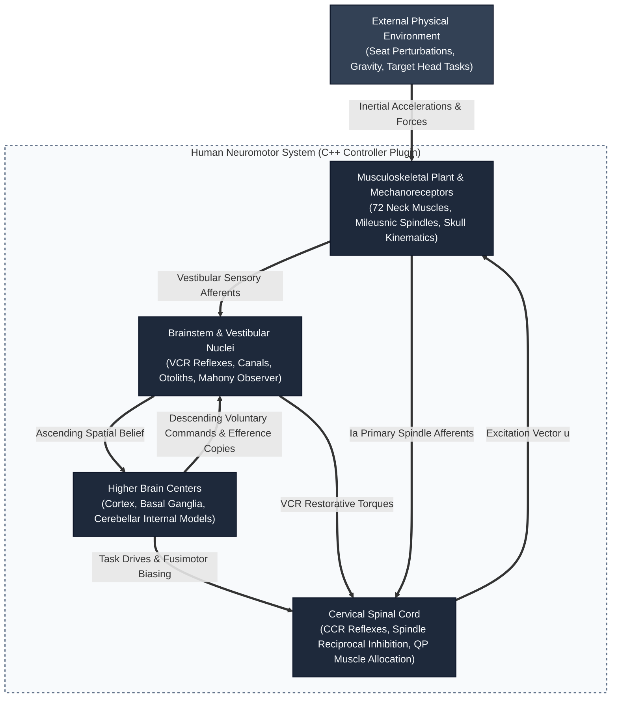
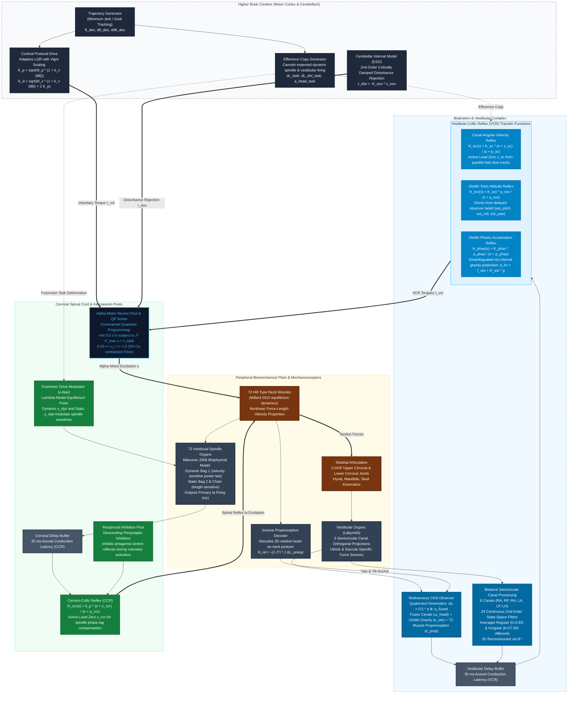

# Full Neuromotor Control & Sensory Feedback Architecture (C4-Anatomical Model)

> [!NOTE]
> **PhD Thesis Architectural Blueprint**  
> This document details the end-to-end multi-tier neural control loops implemented in `HeadNeckNeuralController.cpp` and OpenSim. The architecture maps computational control principles (LQR, Quadratic Programming, Observers, Lead-Lag Transfer Functions) directly to their biological anatomical substrates across four distinct CNS and peripheral hierarchies.
>
> **Last updated:** Phase 2.1 Consolidated Parameterization (October 2026). Key changes: active lead-ratio coupling for zero placement, tightened physiological parameter bounds, removal of unused `k_v` (stretch-velocity derivative gain), unified 35 ms delay for VCR and CCR paths, revised QP co-contraction floor to 3%, and explicit clarification of afferent usage in the CCR loop.

---

## 1. System Context Diagram (Level 1: Overall Closed-Loop Interaction)

---

## 2. Container Diagram (Level 2: Anatomical Boundaries & Information Flow)

---

## 3. Component Details & Mathematical Mechanics

### 3.1 Higher Brain Centers (Motor Cortex & Cerebellum)
* **Cortical Postural Drive ($\vec{\tau}_{\text{vol}}$):**
  Commands relative head-on-neck joint tracking:
  $$\vec{\tau}_{\text{vol}} = \mathbf{K}_p (\vec{\theta}_{\text{traj}} - \vec{\theta}_{\text{rel}}) + \mathbf{K}_d (\dot{\vec{\theta}}_{\text{traj}} - \dot{\vec{\theta}}_{\text{rel}}) + K_i \int \vec{e}_{\text{pos}} dt + \mathbf{I}_{\text{head}} \ddot{\vec{\theta}}_{\text{traj}}$$
  Gains are scaled dynamically by movement vigor $v(t) = 1 + k_v |\dot{\theta}_{\text{traj}}|$ to ensure rapid voluntary saccades while maintaining compliant posture.
* **Cerebellar Extended State Observer (ESO):**
  Reconstructs unmodeled low-frequency physical torques ($\tau_{\text{dist}}$) through a 2nd-order critically damped filter:
  $$\dot{x}_{\text{eso,1}} = \omega_o (y - x_{\text{eso,1}}), \quad \dot{x}_{\text{eso,2}} = \omega_o (x_{\text{eso,1}} - x_{\text{eso,2}}), \quad \vec{\tau}_{\text{eso}} = -K_{\text{eso}} x_{\text{eso,2}}$$
  > [!NOTE]
  > **Disabled during Bode optimization:** $K_{\text{eso}} = 0.0$ during Phase 2.1 CMA-ES campaigns. The ESO state equations are integrated but produce zero torque output. This prevents the disturbance observer from masking true reflex dynamics during frequency-sweep identification.

---

### 3.2 Brainstem & Vestibular Processing
* **Central Spatial Observer (Mahony Quaternion Kinematics):**
  Integrates 3D rotational kinematics using legitimate multisensory fusion:
  $$\dot{\mathbf{q}} = \frac{1}{2} \mathbf{q} \otimes \vec{\omega}_{\text{fused}}$$
  $$\vec{\omega}_{\text{fused}} = \vec{\omega}_{\text{canals}} + K_{\text{oto}} \vec{e}_{\text{oto}} + \mathbf{K}_{\text{prop}} \vec{e}_{\text{prop}}$$
  * **Otolith Error ($\vec{e}_{\text{oto}}$):** Corrects pitch and roll by taking the cross product between measured specific force $\vec{f}_{\text{oto}}$ and internal gravity belief $\hat{\mathbf{R}}^T \vec{g}$.
  * **Proprioceptive Innovation ($\vec{e}_{\text{prop}}$):** Anchor derived from the 72-muscle inverse decoder ($\vec{\theta}_{\text{rel}}$) plus trunk orientation. Clamps canal yaw drift ($K_{\text{prop, yaw}} = 2.0$) while preserving vestibular agility.
* **Bilateral Canal Receptive Fields:**
  Projects head angular velocity onto non-orthogonal anatomical canal planes:
  $$\vec{v}_{\text{canal}} = \mathbf{B} \vec{\omega}_{\text{head}}$$
  Each canal output passes through parallel regular ($k=2.83, T_1=0.0175\text{ s}, T_2=0.0027\text{ s}, T_c=5.7\text{ s}$) and irregular ($k=27.09, T_1=0.03\text{ s}, T_2=0.0006\text{ s}$) 2nd-order bandpass afferent dynamics. Reconstructed via $\mathbf{B}^{-1}$.
* **Active Phase-Lead Zero ($z_{\text{sc}}$):**
  Arises from the dual-path summation of direct canal velocity feedthrough and slow cupula displacement:
  $$H_{\text{sc}}(s) = K_{\text{sc}} \frac{s + z_{\text{sc}}}{s + p_{\text{sc}}} = K_{\text{sc}} \left( \frac{p_{\text{sc}}}{z_{\text{sc}}} + \frac{p_{\text{sc}}(z_{\text{sc}} - p_{\text{sc}})}{z_{\text{sc}}(s + p_{\text{sc}})} \right)$$

---

### 3.3 Cervical Spinal Cord (CCR Reflexes & Muscle Allocation)
* **Biophysical Muscle Spindles (Mileusnic et al. 2006):**
  Computes primary (Ia) nerve firing based on intrafusal mechanical tension:
  $$\text{Ia} = s_{\max} + S \cdot s_{\min}, \quad S = 0.156$$
  $$s_{\max} = \tfrac{1}{2}\!\left(\text{AP}_{\text{bag1}} + \text{pri}_{\text{stat}} + \sqrt{(\text{AP}_{\text{bag1}} - \text{pri}_{\text{stat}})^2 + 10^{-4}}\right)$$
  $$s_{\min} = \tfrac{1}{2}\!\left(\text{AP}_{\text{bag1}} + \text{pri}_{\text{stat}} - \sqrt{(\text{AP}_{\text{bag1}} - \text{pri}_{\text{stat}})^2 + 10^{-4}}\right)$$
  $$\text{pri}_{\text{stat}} = G_{\text{pri,bag2}}\,\text{AP}_{\text{bag2}} + G_{\text{pri,chain}}\,\text{AP}_{\text{chain}}$$
  Dynamic Bag 1 accounts for velocity sensitivity via a non-linear power law ($v^{0.6}$); Static Bag 2 and Chain fibers encode length offset.

  > [!IMPORTANT]
  > **Afferent usage in the CCR loop:** The Mileusnic (2006) spindle model internally computes all three afferent signals. Only **Group Ia (primary)** is logged in the neural history buffer, propagated through the CCR delay, and injected into $H_{\text{ccr}}(s)$. **Group II (secondary)** is computed as the intermediate `pri_stat` term for the Ia blending formula but is **never written to the CCR buffer or used as a separate feedback channel**. **Group Ib (Golgi Tendon Organ)** is computed by the proprioception plugin but is **completely unused** in the reflex controller. Both omissions are deliberate: Group Ia already carries the composite velocity + length signal sufficient for Bode identification, and Ib negative force feedback would destabilize the closed loop at resonance.

* **Alpha–Gamma Coactivation (Fusimotor Drive):**
  Alpha motor commands $u_\alpha$ drive proportional fusimotor coactivation:
  $$\gamma_{\text{dyn},i} = K_{\gamma,\text{dyn}} \cdot u_{\alpha,i}, \quad \gamma_{\text{stat},i} = K_{\gamma,\text{stat}} \cdot u_{\alpha,i}$$
  $\gamma_{\text{dyn}}$ controls Dynamic Bag 1 contractile stiffness (velocity damping gain); $\gamma_{\text{stat}}$ maintains Bag 2 and Chain baseline tension so spindles never go slack during active shortening. The dead parameter `k_v` (hardcoded derivative gain on raw stretch velocity) has been **removed**; velocity damping is now exclusively controlled by the physiological $K_{\gamma,\text{dyn}}$ pathway.

* **Active Zero Placement via Lead Ratio Coupling:**
  Zero frequencies for both VCR and CCR filters are coupled to their poles via biological ratios:
  $$z_{\text{sc}} = r_{\text{lead,sc}} \cdot p_{\text{sc}}, \quad r_{\text{lead,sc}} \in [0.10,\, 0.45]$$
  $$z_{\text{ccr}} = r_{\text{lead,ccr}} \cdot p_{\text{ccr}}, \quad r_{\text{lead,ccr}} \in [0.10,\, 0.45]$$
  Maximum phase lead occurs at $\omega_m = \sqrt{z \cdot p}$. With $r \approx 0.20$–$0.25$, peak lead falls at $\omega_m \approx 8$–$14\text{ rad/s}$ ($1.3$–$2.2\text{ Hz}$) — directly inside the $1.11$–$2.48\text{ Hz}$ resonance transition corridor where the $35\text{ ms}$ delay causes the greatest phase lag.

* **Physiological Parameter Bounds (Phase 2.1):**
  CMA-ES search space is bounded to prevent physiologically implausible solutions:

  | Parameter | Symbol | Lower | Upper | Rationale |
  | :--- | :--- | :---: | :---: | :--- |
  | Canal gain | $K_{\text{sc}}$ | 35 | 95 Nm/(rad/s) | Prevents optimizer from slamming against the 120 hardware ceiling |
  | Spindle stiffness | $k_p$ | 0.80 | 1.70 | Prevents high-stiffness blowouts (Gen 5 failure: $k_p = 1.89$) |
  | Tonic ratio | $r_{\text{ton}}$ | 0.50 | 0.95 | Maintains $K_{\text{ton}} \leq K_{\text{sc}}$ (tonic ≤ canal phasic drive) |
  | Lead ratios | $r_{\text{lead}}$ | 0.10 | 0.45 | Guarantees $30^\circ$–$50^\circ$ phase lead in the resonance corridor |

* **Equilibrium Point ($\lambda$-Model) Fusimotor Biasing:**
  Descending voluntary actions deform the spindle baseline length ($L_{\text{eff}} = L_{\text{norm}} - \Delta L_{\text{task}}$), cancelling self-generated stretch reflex firing during voluntary movement.
* **Spinal Lead-Lag Reflex ($H_{\text{ccr}}(s)$):**
  Compensates for the $35\text{ ms}$ neuromuscular conduction delay via active phase lead:
  $$H_{\text{ccr}}(s) = k_p \frac{s + z_{\text{ccr}}}{s + p_{\text{ccr}}}$$
* **Synergy-Based Reciprocal Inhibition:**
  Presynaptic inhibition suppresses antagonist stretch reflexes during voluntary excitation via a $C^1$-smoothstep gate between $u_\alpha = 0.03$ (fully inhibited) and $u_\alpha = 0.08$ (fully active).
* **Quadratic Programming (QP) Torque Allocation:**
  Solves the multi-muscle redundancy problem for 72 muscles in real time:
  $$\min_{\mathbf{u}} \frac{1}{2} \sum_{i=1}^{72} u_i^2 \quad \text{subject to} \quad \sum_{i=1}^{72} \vec{r}_i \times \vec{F}_{\text{max}, i} u_i = \vec{\tau}_{\text{total}}, \quad 0.03 \le u_i \le 1.0$$
---

## 4. Reflex Integration Summary Table

| Reflex Pathway | Latency | Biological Sensor | Mathematical Transfer Function | Primary Functional Role |
| :--- | :--- | :--- | :--- | :--- |
| **VCR Canal** | $35\text{ ms}$ | 6 Semicircular Canals | $H_{\text{sc}}(s) = K_{\text{sc}} \frac{s + z_{\text{sc}}}{s + p_{\text{sc}}}$ | Dynamic head velocity stabilization (damping high-frequency pert.) |
| **VCR Tonic** | $35\text{ ms}$ | Utricle / Saccule + Mahony | $H_{\text{ton}}(s) = K_{\text{ton}} \frac{p_{\text{ton}}}{s + p_{\text{ton}}}$ | Static gravitational alignment (tilt restoration) |
| **VCR Phasic** | $35\text{ ms}$ | Otolith Disambiguation | $H_{\text{phas}}(s) = K_{\text{phas}} \frac{p_{\text{phas}}}{s + p_{\text{phas}}}$ | Linear acceleration compensation |
| **CCR Spindle** | $35\text{ ms}$ | 72 Muscle Spindles (Ia) | $H_{\text{ccr}}(s) = k_p \frac{s + z_{\text{ccr}}}{s + p_{\text{ccr}}}$ | Head-on-neck relative posture hold & intervertebral stiffness |
| **Voluntary Drive** | $0\text{ ms}$ (feedforward) | Motor Cortex | Adaptive LQR + Vigor Scaling | Intentional gaze redirection & target tracking |
| **Cerebellar Disturbance** | Continuous | Internal Model (ESO) | $H_{\text{eso}}(s) = \frac{K_{\text{eso}} \omega_o^2}{(s + \omega_o)^2}$ | Rejection of unmodeled seat vibration and external loads |
